# README diagram options: the system overview

Ten ways to draw the same picture at the top of [README.md](README.md). Each shows the whole system at a glance:
- a caller and Understudy in front of a lead;
- local answers only after a question graduates;
- everything else forwarded to the lead and learned from;
- audits and demotion keeping it honest;
- the design race choosing a model per question.

Option 0 is the current diagram. The form changes from option to option, the subject doesn't. Every block renders on GitHub
(checked with mermaid-cli 11.4.2). Topic diagrams on single subjects are kept in [docs/diagram-ideas.md](docs/diagram-ideas.md).

## 0 (current)

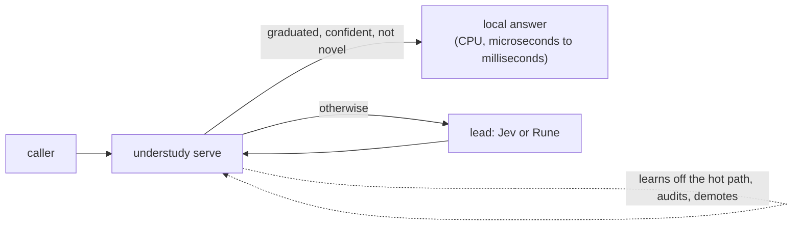

## 1. Left to right, with the learner below

Emphasizes: the request path reads straight across, and learning sits under it.

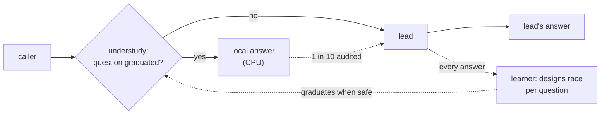

## 2. Top-down layers

Emphasizes: a stack of layers: the caller, Understudy, the learner, then the lead.

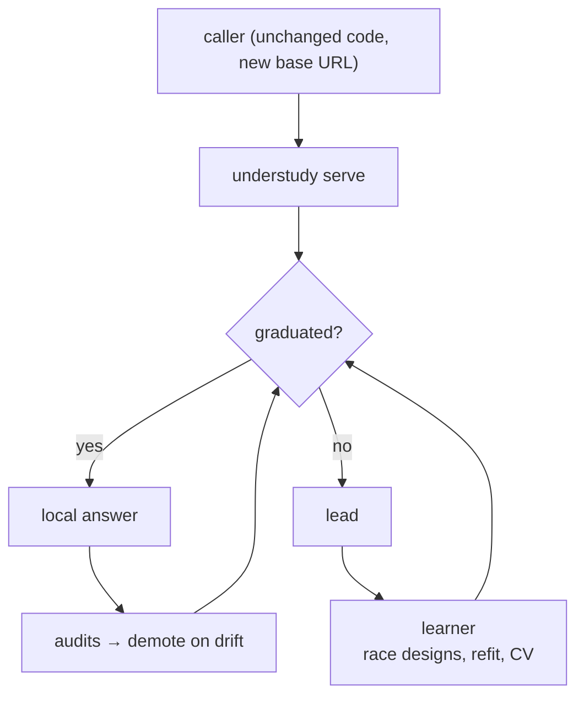

## 3. Hub: Understudy between caller, lead and learner

Emphasizes: Understudy is a hub, and every arrow is one of its jobs.

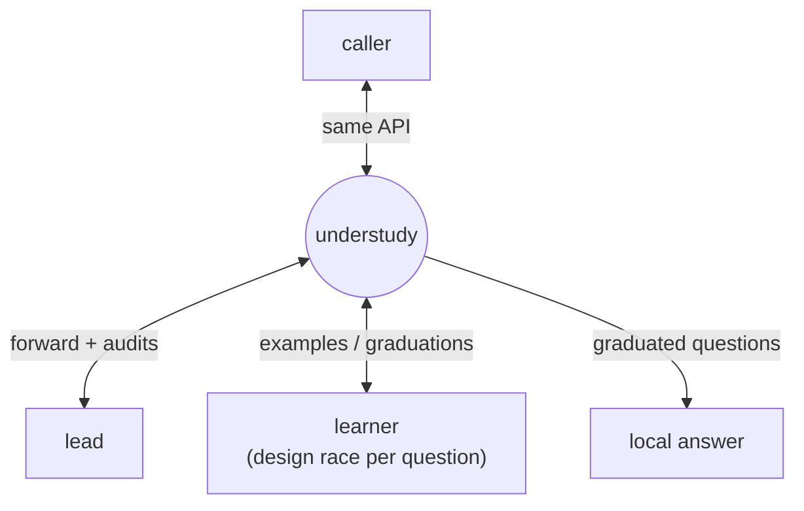

## 4. Swimlanes: caller, Understudy, lead

Emphasizes: who does what, in three lanes.

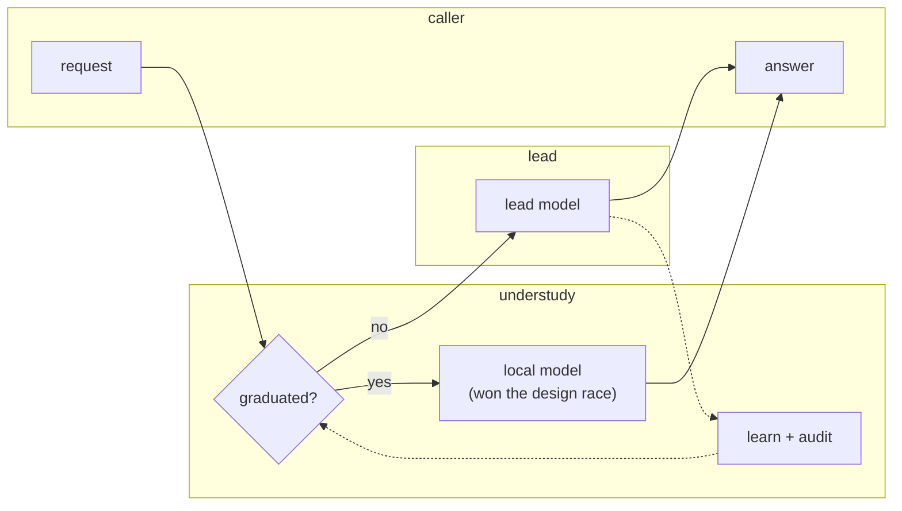

## 5. Minimal: four boxes

Emphasizes: the shortest version that still tells the whole story.

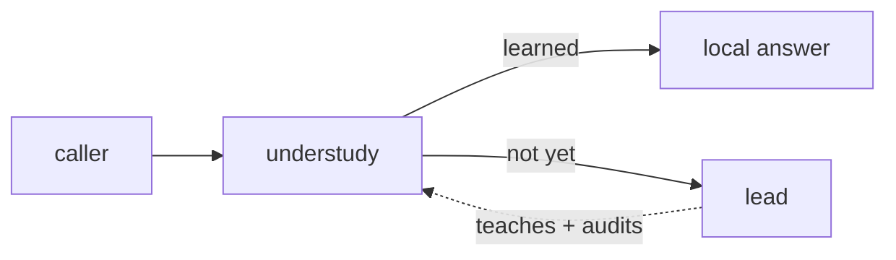

## 6. Hot path versus background

Emphasizes: the request path stays fast, and all the learning happens off it.

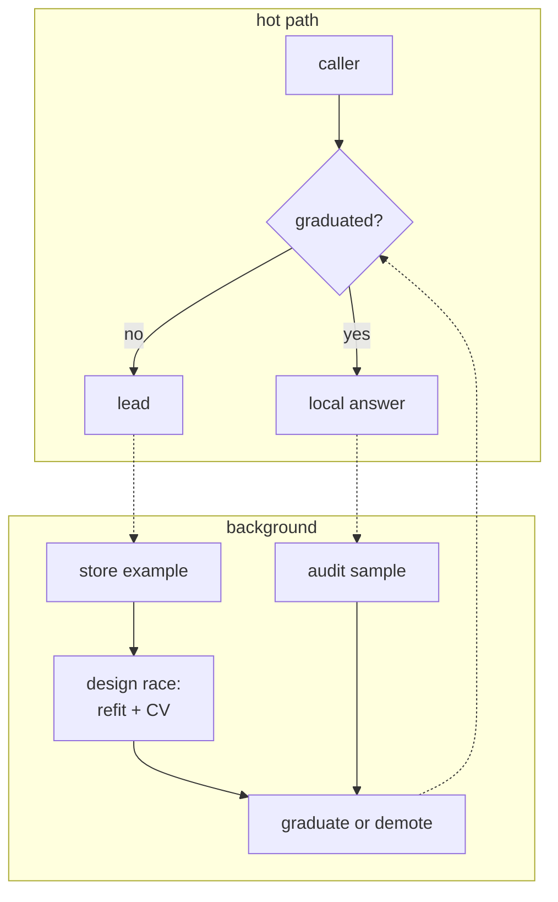

## 7. Per question: several questions at different stages

Emphasizes: Understudy decides question by question, so one request stream holds questions at every stage.

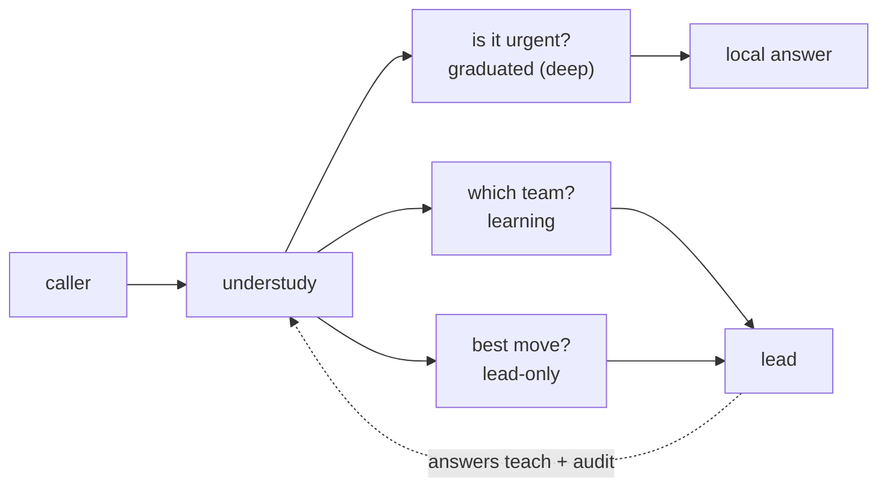

## 8. CPU versus lead calls

Emphasizes: where the work and the money go: cheap CPU answers against paid lead calls.

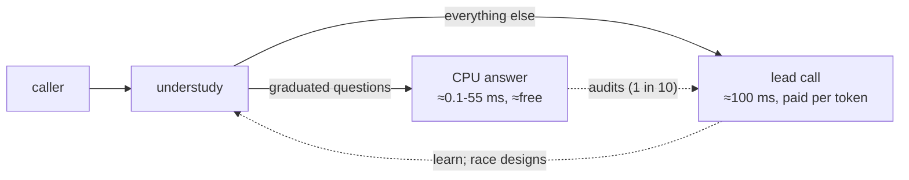

## 9. Sequence diagram

Emphasizes: time order: the first calls go to the lead, and later calls are answered locally.

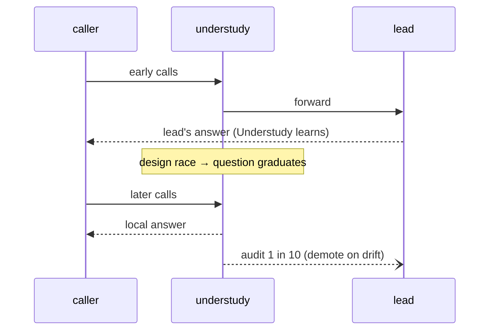

## 10. A loop around the lead

Emphasizes: the flywheel, where answers become training data and audits close the loop.

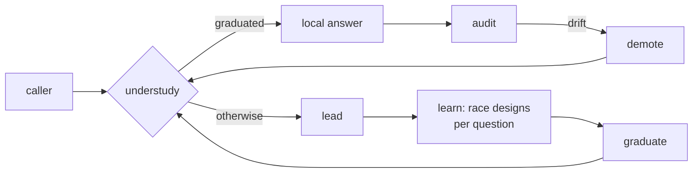
