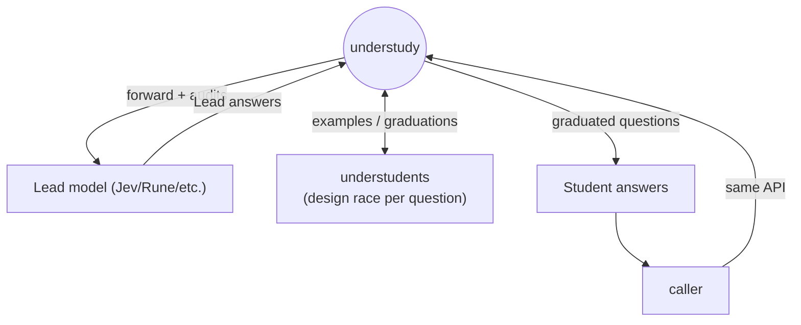
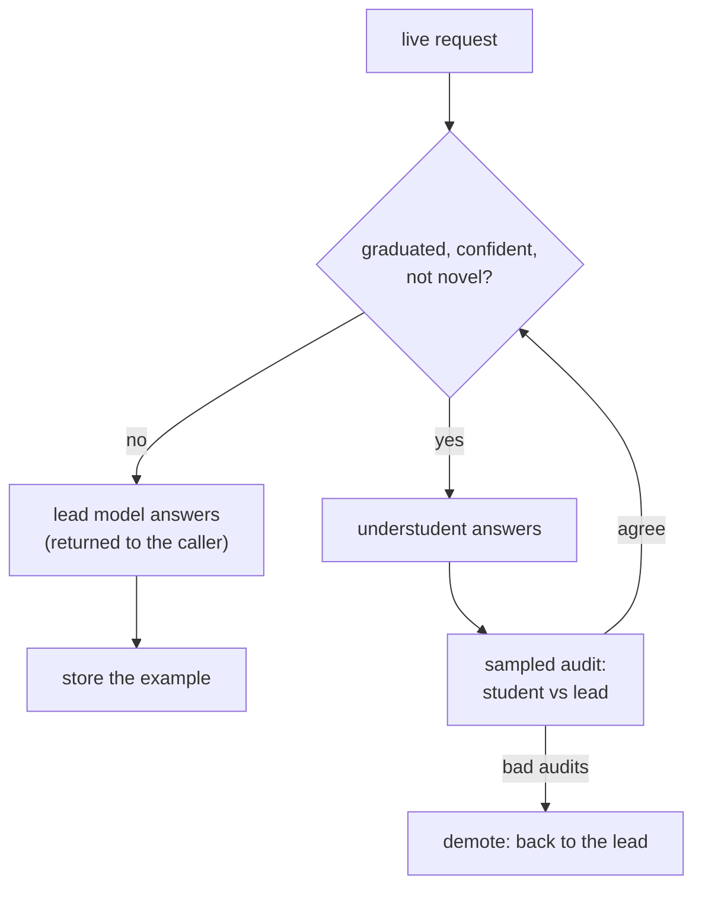
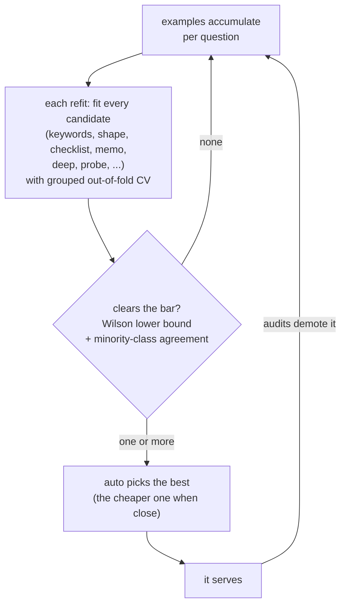

# understudy

I know the meme has been "nobody can possibly spend more than $5 on Jev lol"...

...but across my professional, personal, and academic work at scale, that simply isn't true.

The model itself is named after the Jevons paradox, after all: make intelligence fast enough and cheap enough, and usage
will skyrocket. We're only a couple of months into mastering this game-changing technology, but WOW has that been my
experience. Once your org gets a real handle on what Jev can do, Jev will find itself deeper and deeper in the bowels of
your infrastructure: data pipelines, ETL, MapReduce, event reactors, Kafka consumers, etc.

So we believe software engineers are going to end up spending a _lot_ on System One models. Maybe more so than on LLMs.

If you're not spending a lot on Jev and Jev-likes yet, don't bother. But if you are:

**Understudy is a drop-in, CPU-only proxy for System One models like Jev, Rune, and Clef (the "lead" models).**

It forwards requests to the lead model and trains an "understudent" on the lead's responses: effectively an extremely
narrow distillation of WWJD (What Would Jev Do?).



In truth, it trains a bunch of different students, and the students compete on how well they match Jev/Rune/Clef on
this particular type of request. Students vary in their design, but most are a simple linear model on top of one of
three inputs: hashed word and character n-grams, structural features of the text, or vectors from EmbeddingGemma 2. At
release time there are 11 student designs ([docs/understudents](docs/understudents/README.md)), and several more are in
the works.

## Production Loop

Once a given student reaches near-parity with the lead, it "graduates" ([the statistics](docs/graduation.md)).
Understudy then starts siphoning traffic away from the lead model and answering those requests directly, saving $$.



It never stops auditing the student against the lead, though, because incoming requests change and drift over time,
outliers pile up, and cardinality increases. So it's always ready to pull the switch and demote the student.

## Learning/Graduation Loop

The students for each question compete at every refit, and only one that clears the bar gets to serve.



We think that's kinda cool.

## Scope

Understudy is for narrow, repetitive decisions: yes/no gates, classification, routing, triage, moderation, relevance,
and judging. "Is this support ticket urgent?", "does this passage mention a refund?", "is this tool output an error?":
the question is fixed, only the content varies, and a small model can learn it from a few hundred of the lead's answers.

It won't help with broad single-question decisions over huge state spaces, like choosing a move in a game. Those stay
on the lead and never graduate, and they cost only the forwarding overhead (about 0.3 ms per call, no extra lead spend).
Same for decisions that compare two changing texts (a fresh query against a fresh passage, as in search relevance or
reranking): those are lead-only for these small models. Since nothing is answered locally until it graduates, a question
that can't be learned just stays on the lead.

## Setup

1. **Install**

   ```bash
   cargo install --git https://github.com/endgame-labs/understudy
   ```

2. **Run**

   ```bash
   understudy serve --lead-url <your lead's /v1/systemone URL>
   ```

   It starts in shadow mode: every request still goes to your lead, and Understudy just watches and learns.

3. **Point your app at it**

   Point your app at it. If you use the TypeSafe SDK, that's one environment variable, no code change (it only affects the TypeSafe SDK):

   ```bash
   export TYPESAFE_BASE_URL=http://127.0.0.1:8787
   ```

   The same works with [Fireworks Rune](docs/leads/fireworks-rune.md), [Cloudflare Clef](docs/leads/cloudflare-clef.md) and [OpenAI's Decisions API](docs/leads/openai-decisions.md) (and [TypeSafe Jev](docs/leads/typesafe-jev.md)).

   Any HTTP client can send the same request with curl:

   ```bash
   curl -s http://127.0.0.1:8787/v1/systemone \
     -H 'content-type: application/json' \
     -d '{
       "model": "jev-latest",
       "questions": {
         "urgent": {
           "type": "noul",
           "instructions": "Is this support ticket urgent?",
           "criteria": {
             "true": "the customer cannot work, loses money, or reports a security problem",
             "false": "a question, a request, or a complaint that can wait"
           }
         }
       },
       "state": {
         "subject": "Cannot log in since this morning",
         "body": "Our whole team is locked out and we have a launch today."
       }
     }'
   ```

4. When the log shows it agrees with the lead, restart with `--mode serve`.

### Modes

| `--mode` | Behavior |
|---|---|
| `forward` | Forwards every request to the lead and logs it. Does not train. |
| `shadow` | Forwards every request to the lead, trains on its answers in the background, and logs the candidate local answer (default). |
| `serve` | Answers locally when a question is graduated and confident. Forwards all other requests to the lead. |
| `race` | Calls the lead and the local model concurrently and returns whichever valid answer finishes first. |

See [docs/benchmarks.md](docs/benchmarks.md) for offline replay benchmarking and [docs/examples.md](docs/examples.md) for end-to-end examples.

## API

Request body: `{"model", "questions": {name: {"type", "instructions", "criteria"}}, "state": any JSON}`. Supported question types are `noul` (yes/no), `choice` (one of several options), and `score` (ordered levels).

Response body: `{"model", "answers": {name: answer}, "usage": {...}}`.

- Forwarded responses return the lead's exact bytes with `x-understudy: lead`. Upstream errors (400, 402, 413, 422, 429, and 503 with `Retry-After`) pass through unchanged.
- Local responses return `x-understudy: local` and all-zero `usage` fields. In `serve` mode, a request is answered locally only if every question in the request qualifies.
- `GET /healthz` and `GET /status` report server health and each question's state (`learning`, `graduated`, `demoted`, `lead_only`).

See [docs/api.md](docs/api.md) for the full contract and `curl` examples.

## Graduation

Each question retains its 2,000 most recent lead answers. Every 100 examples, Understudy refits the model and computes 5-fold out-of-fold predictions. A question graduates at the lowest confidence threshold where the out-of-fold predictions at or above that threshold satisfy both conditions:

- The Wilson lower bound of agreement with the lead is at least 0.90 across at least 30 rows.
- The minority class agrees at a Wilson lower bound of at least 0.80.

One-sided variants allow a yes/no question to graduate on "no" only or "yes" only. After graduation, roughly 1 in 10 local answers is audited against the lead. A Wilson bound over the last 100 audits demotes the question if it has drifted. Input states outside the observed training distribution are forwarded as novel. Passing `--graduation sequential` (opt-in) allocates the error budget across refits so repeated evaluations do not graduate a below-target question by chance. See [docs/graduation.md](docs/graduation.md).

## Benchmarks

Every call answered locally avoids a paid lead call. Savings grow linearly with call volume while the understudent uses only CPU time. At the measured lead rate, 80% coverage (72% net of audits) saves about $45,000 per billion calls against about $2 of CPU time with a lightweight design (about $830 with an encoder design), and 5 to 70 times that amount at larger-model prices ([Cost at scale](docs/benchmarks.md#cost-at-scale)). Local inference also lowers latency (about 0.1 ms versus ~80 ms for the lead) and continues serving graduated questions when the lead is slow or unreachable.

The benchmark suite covers 11 synthetic question types (the datasets in [data/](data/README.md)) across both leads with all model designs competing (replay, cold start, target 0.90). Coverage is the share of calls answered locally. Agreement is accuracy against the lead on those calls.

| question type | Jev | Rune | best design (local latency) |
|---|---:|---:|---|
| pairwise preference | **80%** @ 94.2% | **80%** @ 94.2% | keywords (**~0.2 ms**) |
| yes/no gate | **69%** @ 91.5% | **70%** @ 92.3% | deep (~65-90 ms) |
| classify tool output | **58%** @ 97.7% | **64%** @ 97.9% | deep (~65-90 ms) |
| yes/no gate (retry?) | **53%** @ 93.4% | **52%** @ 97.1% | auto / deep |
| error detection | **25%** @ 98.0% | **39%** @ 97.4% | deep / `probe` |
| passage relevance, triage score | 11-14% | 0-16% | deep, partial |
| lookups, graded sentiment, needles in long text | 0% | 0% | **lead-only** |

Lead latency is ~80-90 ms. The lightweight designs answer in about 0.1 ms and the deep encoder design in about 65-90 ms.

See [docs/benchmarks.md](docs/benchmarks.md) for the methodology and [docs/benchmarks.md#results](docs/benchmarks.md#results) for the full results table, per-design latency, per-design coverage, limitations, and caveats.

## Documentation

| page | contents |
|---|---|
| [docs/how-it-works.md](docs/how-it-works.md) | request flow, shadow vs. serve, question lifecycle, novelty forwarding, learning queue, namespaces |
| [docs/graduation.md](docs/graduation.md) | out-of-fold CV, Wilson bounds, graduation modes, refits, audits, demotion, worked calculations |
| [docs/understudents/README.md](docs/understudents/README.md) | model design comparison table and selection criteria |
| [docs/understudents/lite.md](docs/understudents/lite.md) | input-embedding mean and max pooling, microsecond latency, topic and keyword signals |
| [docs/understudents/keywords.md](docs/understudents/keywords.md) | hashed character and word n-grams, no neural network |
| [docs/understudents/probe.md](docs/understudents/probe.md) | layer-8 token mean from the encoder, linear probe |
| [docs/understudents/deep.md](docs/understudents/deep.md) | per-token states, mean/max or learned attention pooling (default) |
| [docs/understudents/neighbors.md](docs/understudents/neighbors.md) | cosine nearest-neighbor vote over past lead answers |
| [docs/understudents/shape.md](docs/understudents/shape.md) | structural features: lengths, shares, markers, JSON types |
| [docs/understudents/blend.md](docs/understudents/blend.md) | n-grams, structural features, and input embeddings in one model |
| [docs/understudents/memo.md](docs/understudents/memo.md) | exact and near-duplicate retrieval of past answers |
| [docs/understudents/rules.md](docs/understudents/rules.md) | LLM-generated regex rules validated on held-out examples |
| [docs/understudents/ladder.md](docs/understudents/ladder.md) | tiered evaluation ordered from cheapest to most expensive; the cheapest eligible tier answers |
| [docs/understudents/auto.md](docs/understudents/auto.md) | per-question candidate racing and lead-only fallback |
| [docs/leads/README.md](docs/leads/README.md) | per-lead setup pages: TypeSafe Jev, Fireworks Rune, Cloudflare Clef, OpenAI Decisions API |
| [docs/security.md](docs/security.md) | data Understudy sees and writes to disk, listener address, key handling |
| [docs/api.md](docs/api.md) | request and response schema, error passthrough, modes, flags, status endpoints, capture log, limits |
| [docs/examples.md](docs/examples.md) | graduating a gate, lead-only fallback on broad questions, replay benchmarking, train ladder |
| [docs/benchmarks.md](docs/benchmarks.md) | benchmark method, metrics, cost at scale, per-question results, limitations |
| [SPEC.md](SPEC.md) | wire types, statistical formulas, file formats, CLI flags, snapshot format |
| [AGENTS.md](AGENTS.md) | repository conventions for coding agents |
| [TODO.md](TODO.md) | pending benchmarks, planned model designs, preview-release checklist, post-release work |
| [bench/](bench/) | `understudy-bench`, the Go harness for dataset synthesis, lead collection, replay, and reporting |

## License

Understudy is released under the MIT license (see [LICENSE](LICENSE)). `vendor/eg2cpu` is MIT OR Apache-2.0 (see its license files and `PATCHED.md`).
