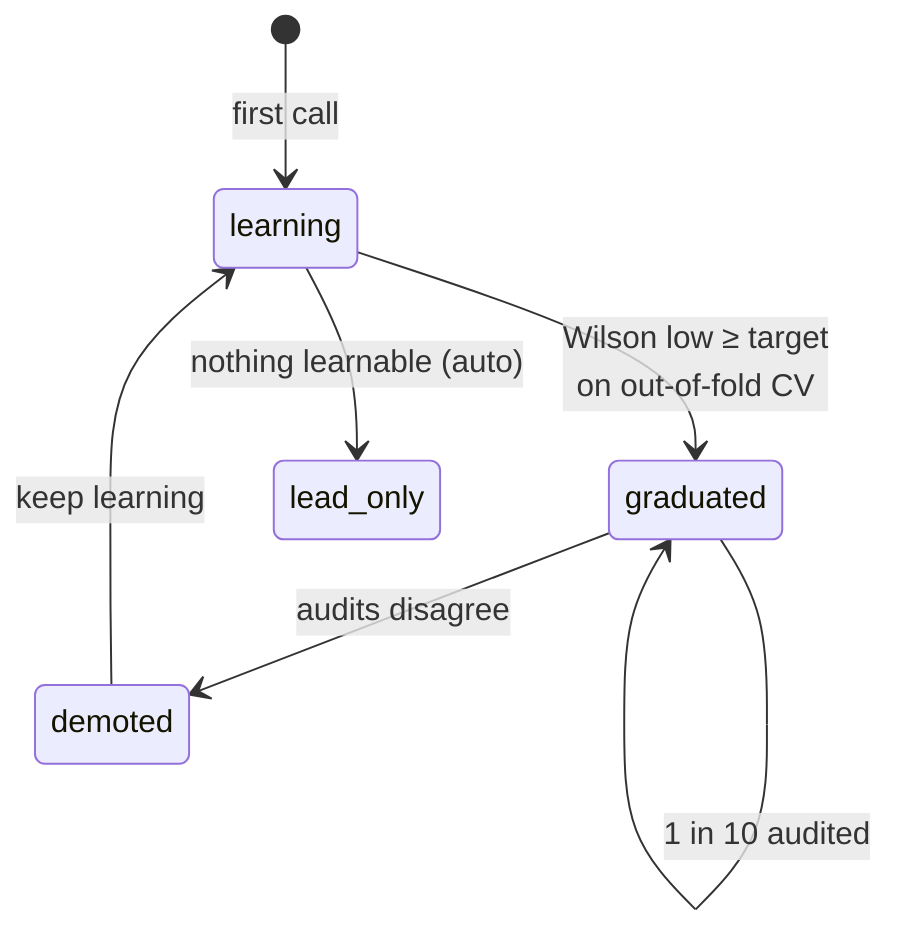
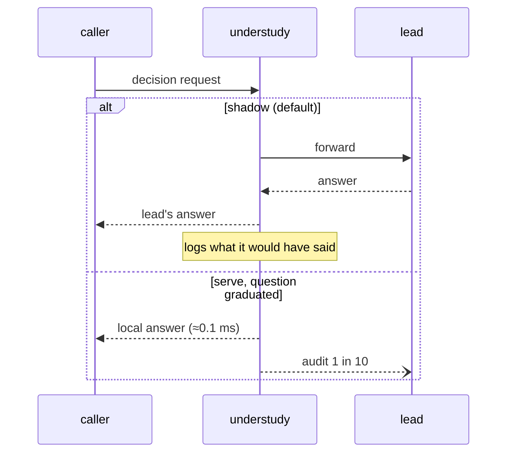
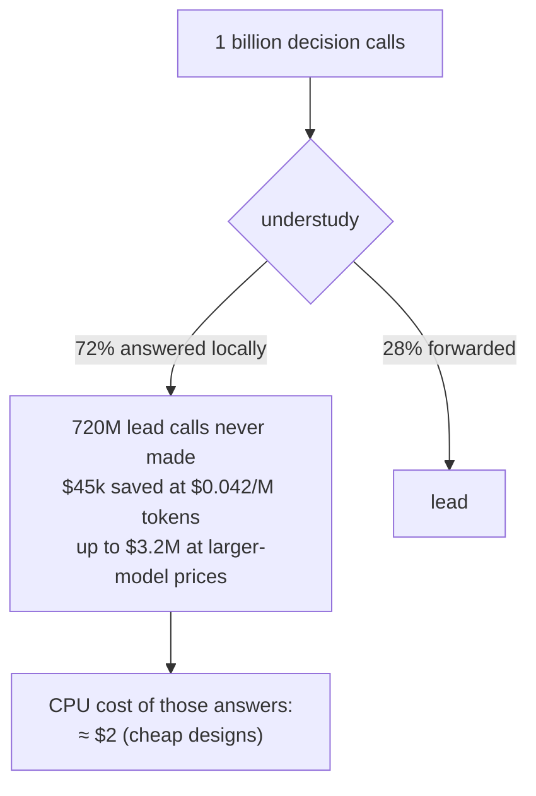
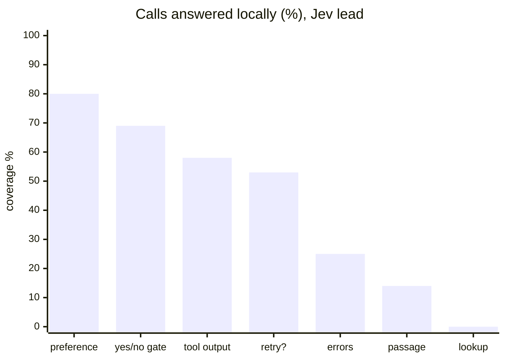
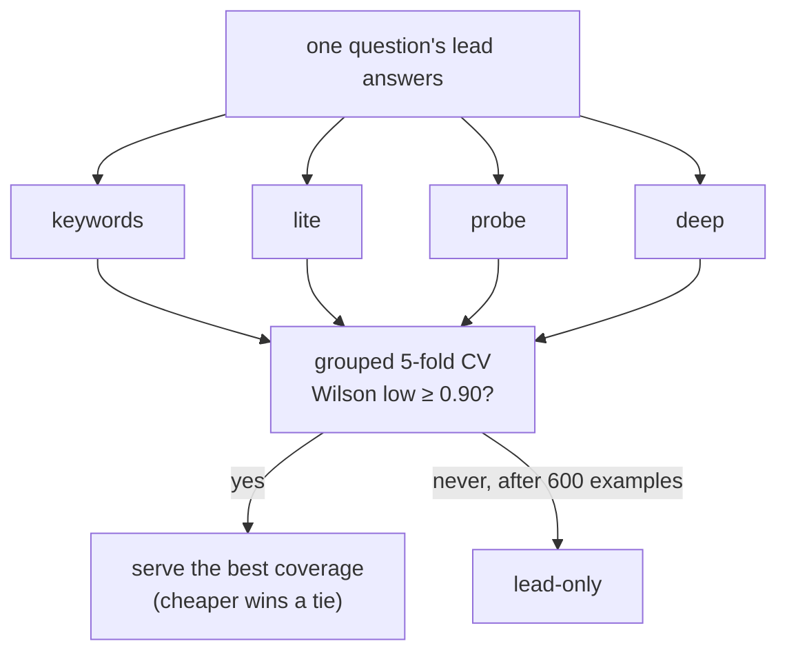
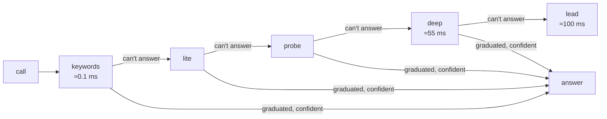
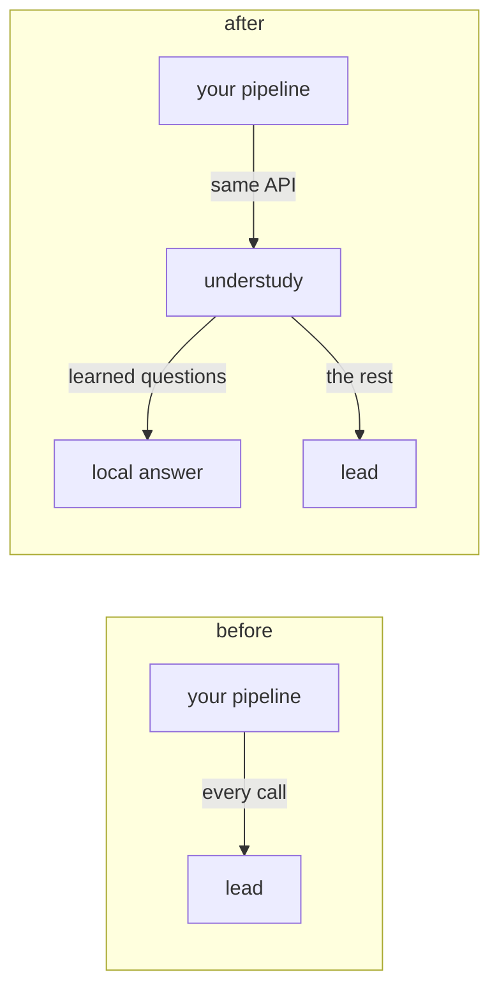
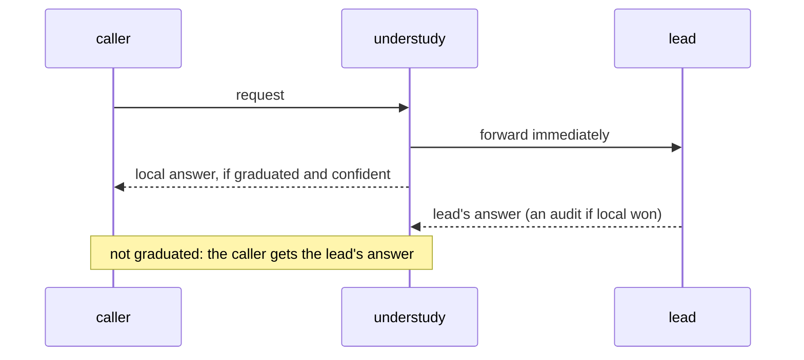
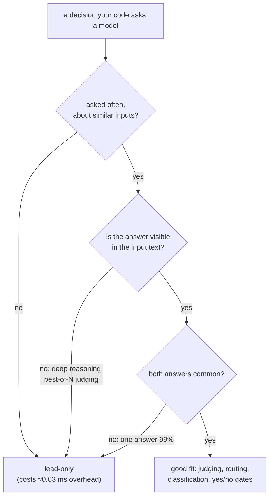
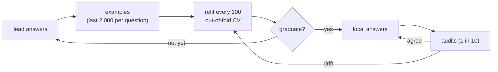

# Diagram ideas

Topic diagrams for possible use in the docs, one idea each. Every block renders on GitHub (checked with mermaid-cli 11.4.2).

## 1. Question lifecycle

Emphasizes: a question earns local answers statistically and loses them when audits disagree.

## 2. One request, shadow versus serve

Emphasizes: shadow is risk-free, and serve is the same pipeline with the local branch switched on.

## 3. Cost at scale

Emphasizes: every local answer is a lead call never paid for, while the CPU cost is a rounding error.

## 4. Where it helps: measured coverage

Emphasizes: real benchmark numbers per question type (share answered locally at 91–98% agreement with the lead).

## 5. The design race, per question

Emphasizes: `auto` races several understudents on each question and serves the cheapest safe winner.

## 6. The ladder: cheapest tier first

Emphasizes: each call tries the cheapest design that may answer, and only falls through to the lead at the end.

## 7. Before and after

Emphasizes: drop-in, because only the base URL changes.

## 8. Race mode: never slower than the lead

Emphasizes: the latency-first mode, where the lead call starts at once and a ready local answer wins.

## 9. Question fit

Emphasizes: a guide to where it helps and where it stays lead-only.

## 10. The learning loop

Emphasizes: the flywheel, where lead answers become training data and audits check agreement.

