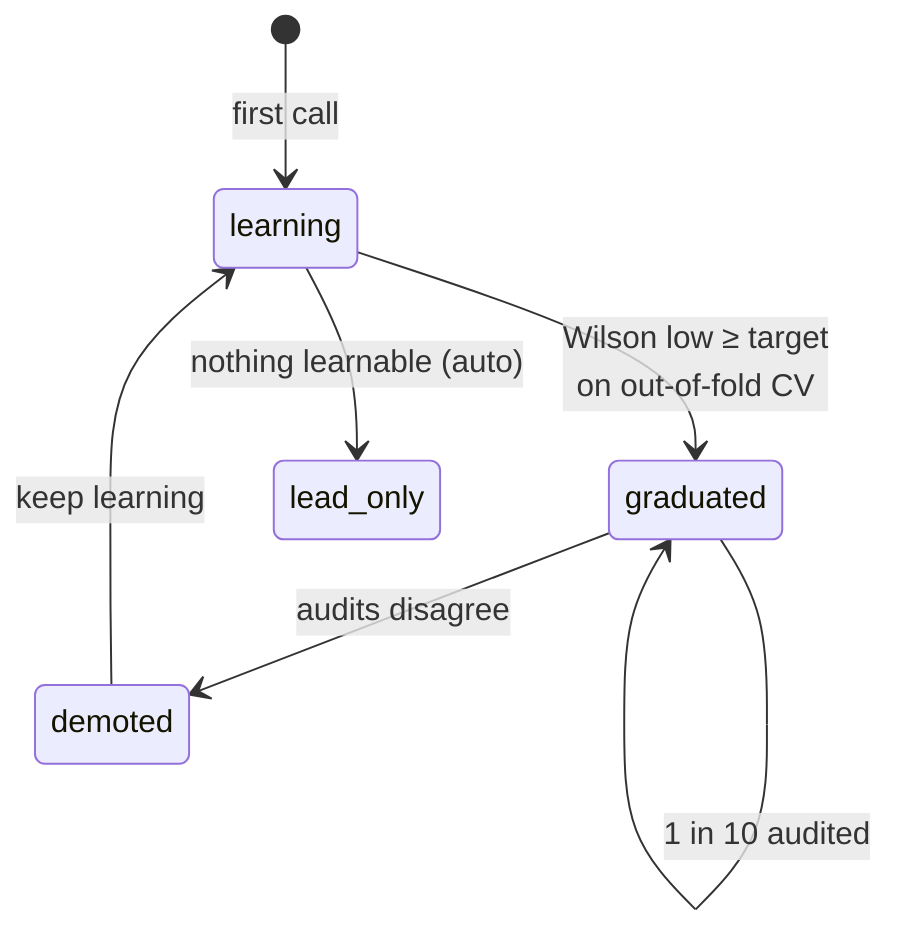
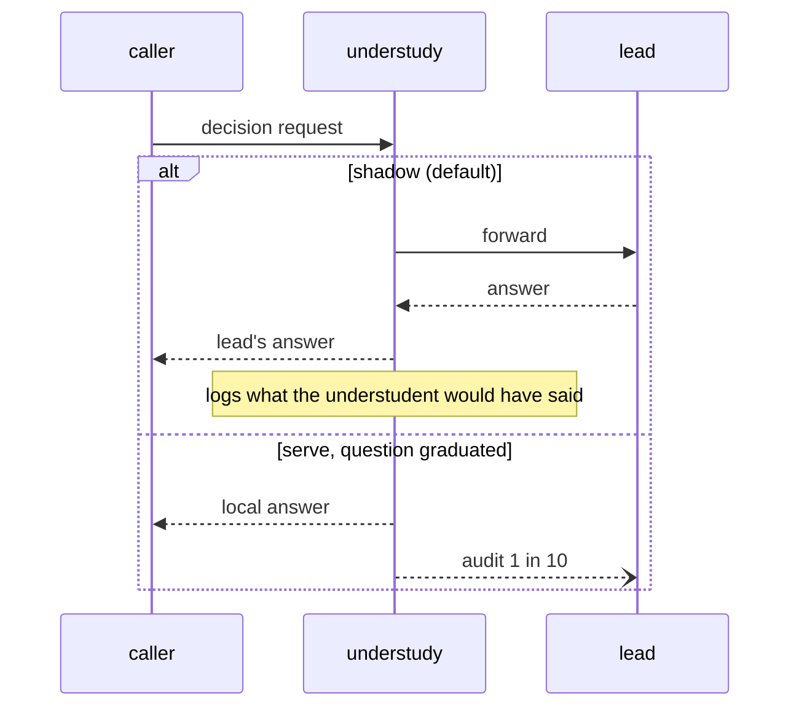
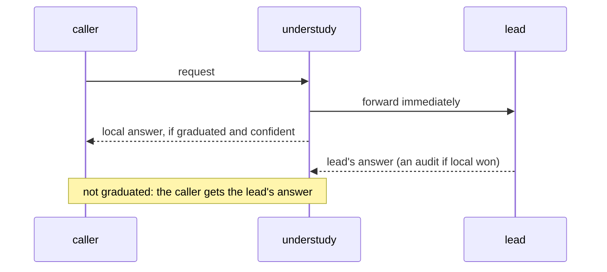
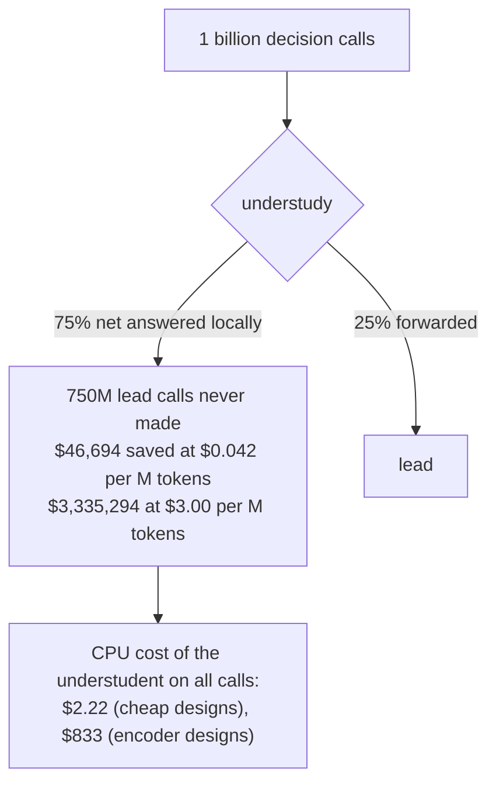
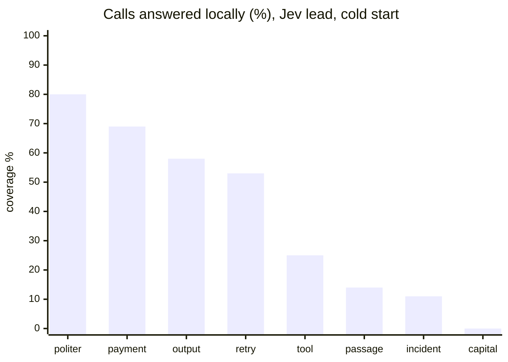
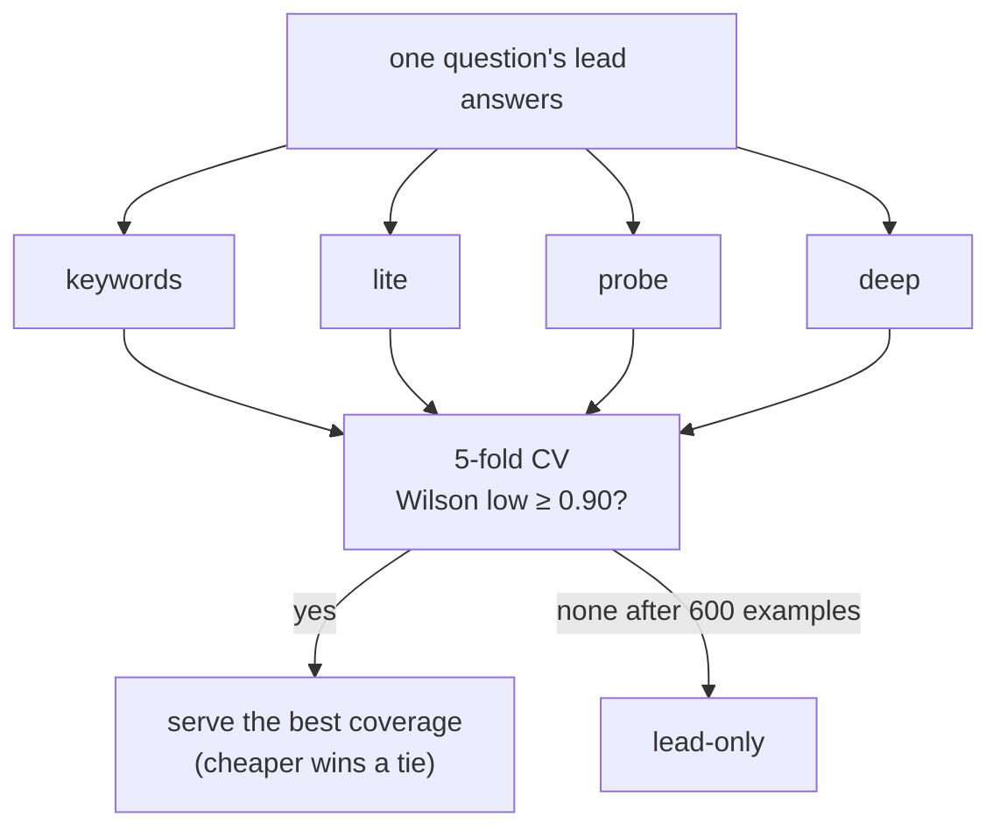
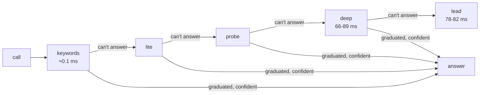
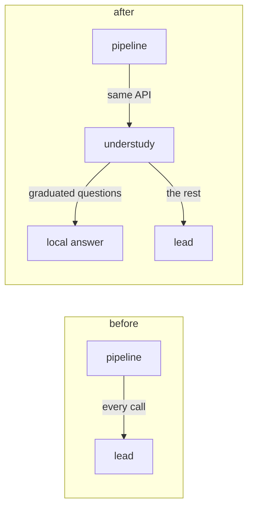
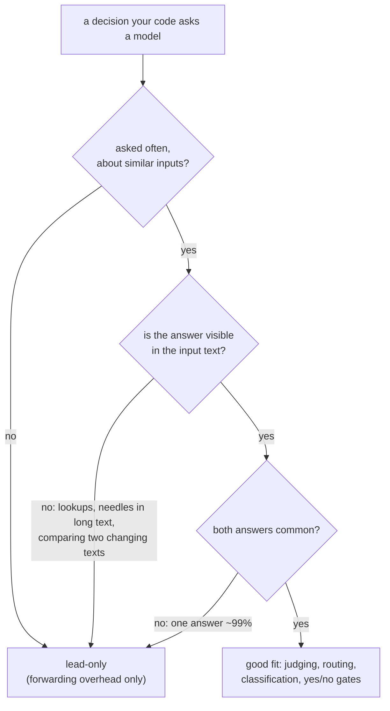

# Auxiliary system diagrams

Further diagrams of how Understudy works, beyond the three in the [README](../README.md).

## Graduation lifecycle

A question earns local answers statistically and loses them when audits disagree. See [graduation](graduation.md).

## Request lifecycle: shadow vs serve

Shadow forwards every request and logs what the understudent would have said. Serve is the same pipeline with the local
branch enabled for graduated questions.

## Request lifecycle: race

Race starts the lead call immediately. A local answer that is graduated, confident, and ready first is returned, and the
lead's response is then used only as an audit.

## Cost at scale

At 75% net local share and the measured lead rate of $0.042 per million input tokens, one billion calls leave 750 million
lead calls unmade. The CPU cost of a cheap design is about $2 per billion calls. Figures are from
[Cost at scale](benchmarks.md#cost-at-scale).

## Coverage by question

Share of calls answered locally over the cold-start stream, Jev as the lead, from
[Results](benchmarks.md#results). Questions that never graduate (`capital_city`, `code_lookup`, `customer_frustration`,
and `secret_needle`) score 0.

The x-axis labels abbreviate `politer_reply`, `payment_flip`, `output_kind`, `retry_exception`, `tool_failed`,
`passage_answers`, `incident_severity`, and `capital_city`.

## Design race

`auto` fits several understudent designs on each question's examples and serves the best one that clears the bar. See
[auto](understudents/auto.md).

## The ladder

Each call tries the cheapest tier that may answer and reaches the lead only when no tier does. Latencies are p50 from
[Latency](benchmarks.md#latency). See [ladder](understudents/ladder.md).

## Before and after

Adopting Understudy changes only the base URL the pipeline calls.

## Question fit

Understudy helps on questions asked often, about similar inputs, with an answer visible in the text. Other questions stay
on the lead. See [Scope](benchmarks.md#scope).

