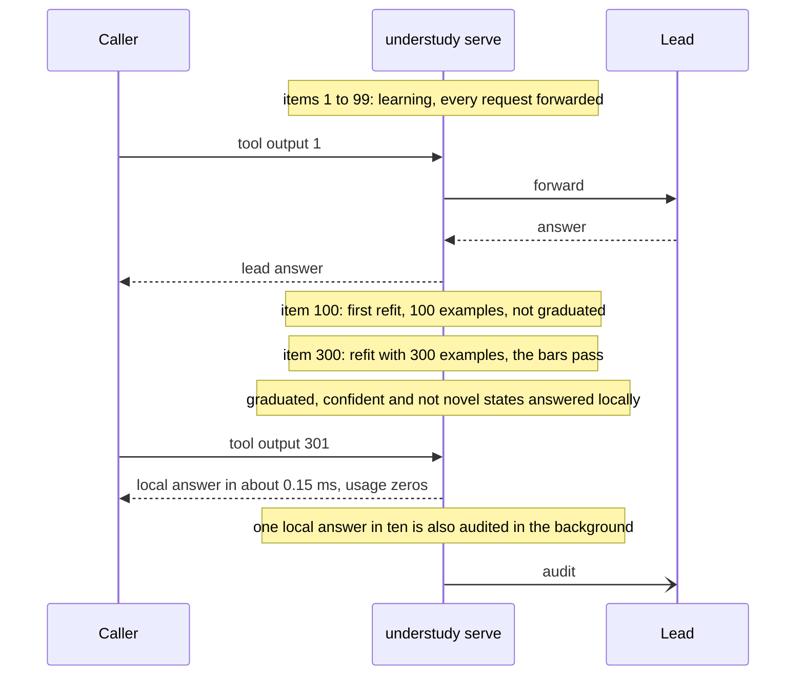
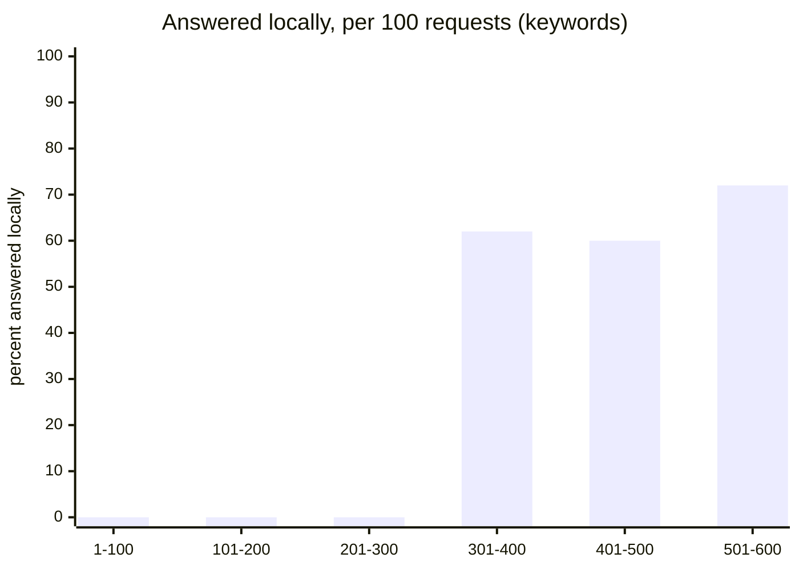
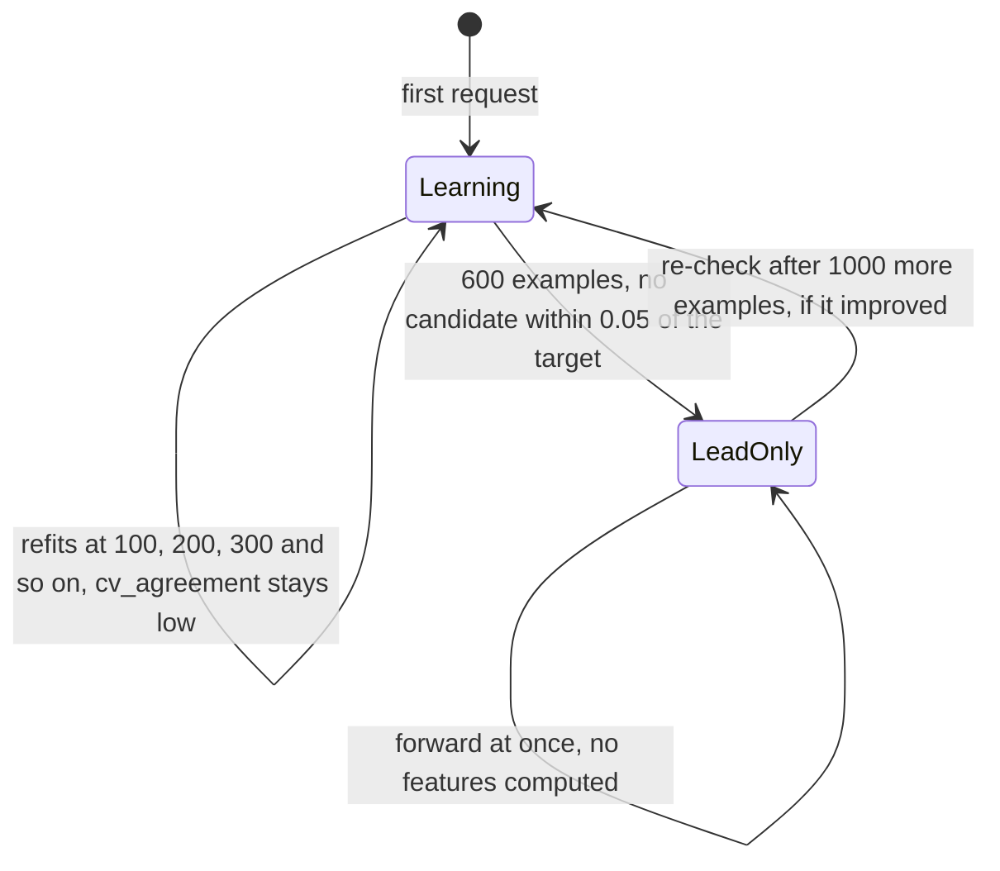
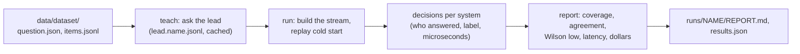
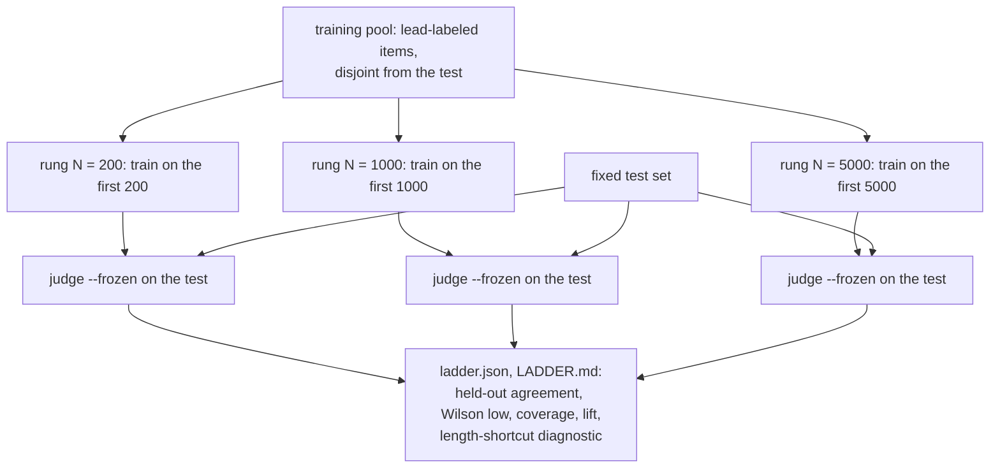

# End-to-end examples

Three stories: a narrow gate that graduates, a broad question that never does, and a replay benchmark with a training
ladder. Numbers marked *measured* come from committed replays in `runs/`; the rest are illustrative.

- [A. A narrow yes/no gate graduates](#a-a-narrow-yesno-gate-graduates)
- [B. A broad question stays lead-only](#b-a-broad-question-stays-lead-only)
- [C. Replay benchmarking with understudy-bench](#c-replay-benchmarking-with-understudy-bench)

## A. A narrow yes/no gate graduates

The question, asked about every tool call an agent makes:

```json
{"type": "noul",
 "instructions": "Is this tool output an error?",
 "criteria": {"true": "the tool call failed: it errored, was rejected, or timed out",
              "false": "the call succeeded, even if its output mentions errors in content it printed"}}
```

States look like `{"call": "read_file(path='aliases.sh')", "output": "alias ll='ls -laF'\nexit code 0", "tool": "bash"}`.
The caller sends each one to the lead through `understudy serve`. Here is what happens to this one question.



### Coverage over time

A committed cold-start replay of 600 items of exactly this kind of question, with the `keywords` understudent and Rune as the lead
(`runs/v1-target97/tool_failed`; an earlier code revision, so a rerun can differ in detail). Share of requests answered
locally, per 100 requests:



| refit | at item | examples | cross-validated agreement | mode | coverage by cross-validation | in force for |
|---|---|---|---|---|---|---|
| 1 | 100 | 100 | 0.840 | none (learning) | 0% | items 101 to 200 |
| 2 | 200 | 200 | 0.855 | none (learning) | 0% | items 201 to 300 |
| 3 | 300 | 300 | 0.893 | one-sided | 65% | items 301 to 531: 142 of 231 answered locally |
| 4 | 531 | 400 | 0.900 | symmetric, threshold 0.86 | 67.5% | items 532 to 600: 52 of 69 answered locally |

Refits fire every 100 **examples**, not every 100 requests. Once local answers start, only forwarded requests (and audited
local ones) become examples, so the fourth refit waited until item 531.

Over the whole stream: 194 of 600 answered locally (**32.3%**, 64.7% of the second half), **98.5%** agreement with the lead
on those 194 answers, 15 audits, 0 demotions. The understudent's own time per item: mean about 200 µs, p50 145 µs, p95 506 µs.
Nothing was answered locally until the question had 300 examples: learning costs nothing but patience, and the first 300
requests were forwarded exactly as if Understudy were not there.

### Running

```bash
# shadow first: nothing changes for the caller, and the capture log shows what it would answer
understudy serve --mode shadow --understudent keywords --snapshot-dir snapshots --capture capture.jsonl &

# send traffic (your caller, pointed at http://127.0.0.1:8787/v1/systemone), then:
curl -s http://127.0.0.1:8787/status | jq '.namespaces[].learners'
jq -c '.questions[] | {state: .learner_state, would: .understudent.would_answer_local, agree}' capture.jsonl | tail

# when the capture log's agreement is where you want it:
understudy serve --mode serve --understudent keywords --snapshot-dir snapshots
```

The snapshot directory keeps what was learned across restarts, so a restart does not forget a graduated question.

## B. A broad question stays lead-only

Now a question with a huge state space: "Which move should the player make next?", a `choice` over dozens of moves, where
every state is a different board and the right answer depends on look-ahead. No cheap model can learn that from a few
thousand answers.



What the three phases cost, with `--understudent auto` (the default candidates are `keywords,lite,probe,deep`):

| phase | requests | what the caller sees | extra work |
|---|---|---|---|
| learning | 1 to 600 | the lead's answer, unchanged | every candidate's features per example, off the hot path |
| lead-only | 601 onward | the lead's answer, unchanged | **none**: no features, no model, refits every 1,000 examples |
| re-check | every 1,000 examples | the lead's answer, unchanged | one refit of every candidate in the background; the verdict lifts only if a candidate graduates |

On the request path all three phases are the same thing: parse, forward, answer. The measured cost of that, shadow mode
against a direct call to a local fake upstream with a fixed 100 ms latency (1,000 calls per side, an 8-option
request): **added p50 0.27 to 0.48 ms, p95 1.2 to 1.3 ms, p99 1.4 to 2.1 ms**, with no differing statuses or bytes.
Roughly 0.3 ms on a call that takes 100 ms or more, and $0 in lead spend because Understudy never answers and never adds
a lead call (audits only exist for local answers).

The committed synthetic replays show the same shape on a smaller scale. A lookup question and two graded questions
(`code_lookup`, `incident_severity`, `customer_frustration` in `runs/v1-target97`) never graduated for any understudent, which
is correct behavior: the lead answered them well, and no cheap model matched it above the bar.

Why this is the safe default: **a question is answered locally only once it has graduated.** A question that cannot be learned
never does.

## C. Replay benchmarking with understudy-bench

`understudy-bench` replays recorded lead answers through the understudent, so a benchmark needs no live calls once the lead's
answers are on disk.



```bash
cargo build --release                                     # target/release/understudy
(cd bench && go build -o ../target/understudy-bench .)    # the harness

# 1. a dataset: data/<name>/{question.json, items.jsonl, lead.<lead>.jsonl}
#    committed examples exist under data/ (a small synthetic set per decision kind)
target/understudy-bench datasets                          # what synth can build

# 2. replay, cold start, no network (the lead's answers are recorded)
target/understudy-bench run --run try1 --lead rune \
  --datasets tool_failed,output_kind \
  --systems understudent:keywords,understudent:deep,understudent:auto

# 3. the report
target/understudy-bench report --run try1                 # runs/try1/REPORT.md and results.json
```

`--systems` accepts `understudent:<deep|probe|keywords|lite|neighbors|shape|blend|memo|ladder|auto>` (and `hunch`, an optional external
baseline that needs the Python runner). Extra understudent flags go through `--understudent-arg`, for example
`--understudent-arg --candidates --understudent-arg keywords,lite,probe,deep,shape,blend,memo` for an extended `auto` race.
`--mode split` seeds the understudent with the first `--train` items and judges the rest (a warm start).

The report has a **Usefulness** section per dataset and system: coverage, agreement with the lead on the answered share and
its Wilson lower bound, the understudent's latency p50 and p99, the lead's latency, and dollars saved per million calls. See
[benchmarks](benchmarks.md) for the method.

### Train ladder

A replay asks "how quickly does it learn from live traffic". A **train ladder** asks a different question: "if you give it N
labeled examples up front, how good is it on a fixed test set". Every rung is scored on the *same* held-out items.



```bash
target/understudy-bench run --run ladder1 --lead jev \
  --data-dir mydata \
  --datasets my_test_set \
  --train-pool my_test_set=my_training_pool \
  --train-ladder 200,1000,2000,5000 \
  --systems understudent:deep,understudent:probe,understudent:keywords,understudent:lite
target/understudy-bench report --run ladder1 --data-dir mydata   # runs/ladder1/LADDER.md
```

Each rung runs `understudy train --max-examples N` on the first N lead-labeled items of the pool and then
`understudy judge --frozen` over the test, so nothing is learned from the test. Rungs beyond the pool's labeled prefix are
skipped, not failed. A rung fails if the fit used fewer than N examples after removing duplicate states. The pool must be
disjoint from the test (a shared id or an equal prompt rejects the run; near-duplicates are excluded with all their
sub-items). Each rung reports: grouped-CV agreement and coverage, held-out agreement of the understudent's own label with the
lead, the majority-class share (the number to beat), lift over it, the held-out Wilson lower bound, and whether it clears
0.90, plus coverage and local agreement. When the test states carry a `response`, a **length-shortcut diagnostic** is added
(the lead's and the understudent's yes-rate by response-length quartile), which shows whether a learned length cue explains a
result; see [SPEC.md](../SPEC.md).
