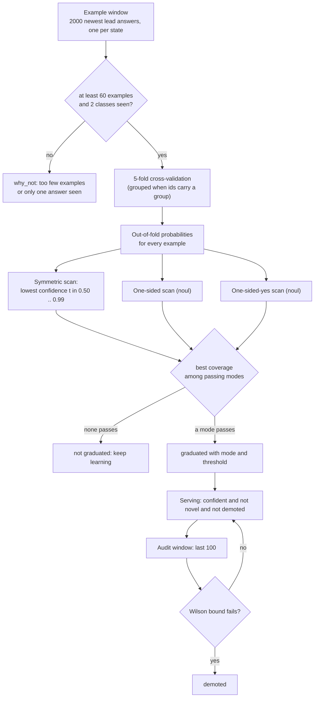
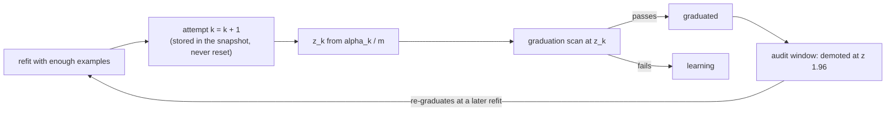
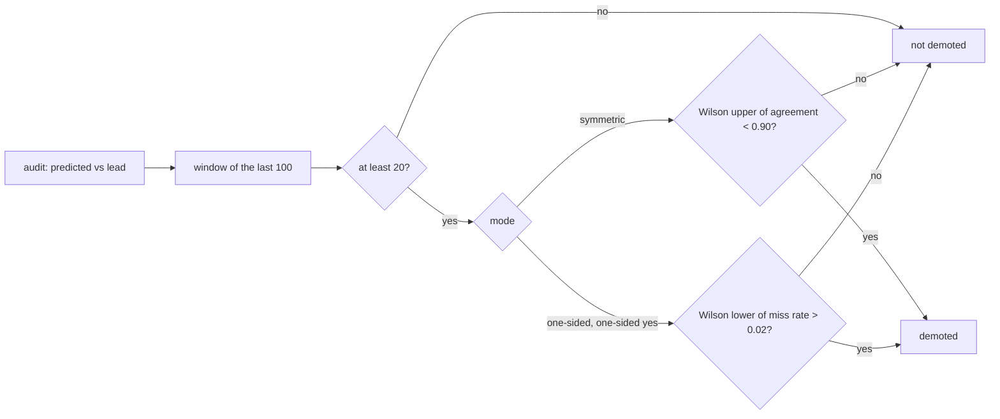

# Graduation, audits, and demotion

A question's understudent answers locally only after it *graduates*. Graduation is a statistical test run at every refit
on **out-of-fold** predictions, so the understudent is graded only on rows it was not trained on. After graduating, a
rolling audit window keeps testing it, and a bad window demotes it.

This page gives the exact rules. The same code runs for every [understudent design](understudents/README.md); a design
supplies only features, a model, and a novelty vector. [SPEC.md](../SPEC.md) lists the constants in reference form.

- [The pipeline](#pipeline)
- [Examples and labels](#examples-and-labels)
- [Cross-validation](#cross-validation)
- [Wilson lower bound](#wilson-lower-bound)
- [Repeated looks: `--graduation sequential`](#repeated-evaluation---graduation-sequential)
- [The three modes](#the-three-modes)
- [When refits happen](#when-refits-happen)
- [Eligibility at request time](#eligibility-at-request-time)
- [Audits and demotion](#audits-and-demotion)
- [All the numbers](#constants)
- [Worked numbers](#worked-examples)

## Pipeline



## Examples and labels

- Each question keeps a rotating window of the **2,000 most recent lead answers** (`sampled_cap`). One example per state
  hash: a new answer for a state replaces the old one.
- The label is the **argmax** of the lead's probabilities. The weight is the lead's **confidence** (its highest
  probability). A bare label with no probabilities weighs 1.0.
- Ground-truth labels given through `understudy train` (`{"truth": k}`) weigh 2.0, live in a separate window (the newest
  5,000 per class) and replace the sampled answers for the same state in fits.

## Cross-validation

The fit makes **5-fold** out-of-fold (OOF) predictions: the examples are shuffled with a seeded generator (seed 0), each
fold is predicted by a model trained on the other four, and a final model is fitted on all examples for serving. The
OOF probabilities are what graduation sees.

Request ids may carry a group, `<item>#<k>`, for the per-response sub-items of one item. Grouped CV keeps a group on one
side of every split:

| groups | folds |
|---|---|
| none (ordinary ids) | plain 5-fold |
| 5 or more | 5-way group K-fold |
| 2 to 4 | one fold per group |
| fewer than 2 | the understudent declines to graduate and says why (`fewer than 2 id groups`) |

In `understudy serve`, `x-understudy-group: G` on a request makes its examples group `G`, so cross-validation never
splits one game, conversation, or document.

## Wilson lower bound

All bars use the 95% Wilson score interval (z = 1.96) for `k` successes in `m` trials. With `p = k/m`:

```
centre = (p + z²/2m) / (1 + z²/m)
half   = z · sqrt(p(1−p)/m + z²/4m²) / (1 + z²/m)
interval = [centre − half, centre + half]
```

A rate of 93% over 30 rows has a lower bound of about 0.79, so small samples cannot clear a 0.90 bar. That is the
point: graduation needs both a high agreement rate *and* enough rows to believe it.

## Repeated evaluation: `--graduation sequential`

Every refit re-tests graduation, so a question gets a new chance to pass at every refit. A question whose true agreement
is below the target can clear a *pointwise* 95% bound by luck at some refit, and the more refits it gets, the likelier that
is. Audits and demotion catch it afterwards; `--graduation sequential` makes the bar itself account for the repeated looks.
The default is `pointwise` (everything above, unchanged and byte-identical in the snapshot).

Sequential **spends alpha across attempts**. A question's *attempt counter* `k` counts the refits that ran the graduation
test (at least `--min-examples` rows and two classes seen). Attempt `k` tests every Wilson bound of the scan at the
two-sided level

```
alpha_k = 0.05 * 6 / (pi² k²)          (the sum over all k is at most 0.05)
z_k     = -Phi⁻¹(alpha_k / 2 / m)      m = candidates raced in the attempt (1 for a single understudent)
```

| attempt k | 1 | 2 | 3 | 5 | 10 | 20 | 30 |
|---|---|---|---|---|---|---|---|
| z, one candidate | 2.16 | 2.67 | 2.93 | 3.24 | 3.61 | 3.96 | 4.15 |
| z, four candidates | 2.67 | 3.11 | 3.34 | 3.61 | 3.96 | 4.28 | 4.45 |

The same `z_k` goes into every bar of the scan: agreement and minority agreement of the symmetric mode, the recall lower
bound and the miss upper bound of both one-sided modes, the `rules` understudent's graduation, and the certificate of
`--abstain calibrated`. A ladder's tiers and auto's candidates are tested in the same attempt, so `m` is their number
(Bonferroni on top of the spending). Demotion's audit bounds keep z = 1.96: demotion is the safety net, not a graduation.



The counter is per question and **never resets**: a demoted question that re-enters graduation continues from its current
`k`, and so does a question that stops and starts graduating. A ladder's cheap-tier refits (every 25 examples) count as
attempts for the whole question, so a ladder reaches a large `k` sooner. The refit report (replay's `refits[].graduation`) shows `{policy, attempt, z, candidates}`.

What it does not cover: the 50-threshold scan inside one attempt (a pre-existing multiplicity, which `--abstain calibrated`
removes), and nothing assumes the refits' windows are independent (the spending is a union bound, so overlapping windows only
help). The price is coverage: `z_k` keeps growing, so a question just above the target graduates later, or loses
graduation at a later refit, while a question far above it barely notices.

### Simulation: a question just below the target

`cargo run --release --example sequential_sim` runs the real scan on synthetic rows: a rotating window (2,000) of rows that agree
with the lead with a known probability, tested at 30 refits 100 examples apart; 30% minority rows; target 0.97, minority
bar 0.80; 1,000 trials per cell. `flat`: one confidence level (one threshold). `scan`: confidence uniform in [0.5, 1), so the
0.50..0.99 threshold scan also runs. `x4`: four independent candidates, the question graduates if any does.

| true agreement | confidence | candidates | pointwise: P(ever graduates in 30 refits) | sequential: P(ever graduates) |
|---|---|---|---|---|
| 0.95 | flat | 1 | 0.0% | 0.0% |
| 0.955 | flat | 1 | 0.1% | 0.0% |
| 0.96 | flat | 1 | 0.4% | 0.0% |
| 0.965 | flat | 1 | 1.9% | 0.0% |
| 0.96 | flat | 4 | 3.0% | 0.0% |
| 0.965 | flat | 4 | 8.2% | 0.0% |
| 0.96 | scan | 1 | 6.8% | 0.0% |
| 0.965 | scan | 1 | 20.3% | 0.0% |

Pointwise's chance of ever graduating a below-target question is small for one threshold but grows with the number of
candidates and with the threshold scan (20% at 0.965 with the scan). Sequential's is 0.0% in every cell (well under the
nominal 0.05; the union bound is conservative and the Wilson bound is conservative near the edge).

### Simulation: the coverage cost when the question is fine

Same harness, true agreement above the target:

| true agreement | confidence | candidates | policy | P(ever graduates) | mean first graduation (refit) | share of 30 refits graduated | coverage at refit 30 |
|---|---|---|---|---|---|---|---|
| 0.99 | flat | 1 | pointwise | 100.0% | 3.3 | 91.8% | 100.0% |
| 0.99 | flat | 1 | sequential | 99.7% | 9.5 | 69.3% | 96.8% |
| 0.99 | scan | 1 | pointwise | 100.0% | 2.9 | 93.3% | 100.0% |
| 0.99 | scan | 1 | sequential | 100.0% | 8.8 | 72.0% | 97.3% |
| 0.99 | flat | 4 | pointwise | 100.0% | 2.1 | 96.2% | 100.0% |
| 0.99 | flat | 4 | sequential | 100.0% | 8.0 | 75.7% | 100.0% |
| 0.995 | flat | 1 | pointwise | 100.0% | 2.3 | 95.5% | 100.0% |
| 0.995 | flat | 1 | sequential | 100.0% | 5.3 | 85.5% | 100.0% |

At 0.99 against a 0.97 target the question graduates about six refits (600 examples) later and is graduated for about
three-quarters instead of nine-tenths of the refits. A tight margin is where the cost lies: z grows with `k` while the
window stays at 2,000 rows, so the Wilson lower bound at 0.99 falls from 0.982 (z 1.96) to 0.966 (z 4.14) at 1,000 rows.

### Replays on recorded lead answers

Offline replays (no API calls) of the committed streams, cold start, defaults otherwise (target 0.90, minority 0.80, audit rate
0.10, seed 0): `understudy replay --understudent U --graduation pointwise|sequential`. Lead: Jev for `tool_failed`,
`passage_answers`, and `incident_severity`. Each cell is coverage (share of items
answered locally over the whole replay, learning included) / realized agreement with the lead's recorded answer on those (Wilson
lower bound). The last column is the item at which the question first graduated (refits run every 100 items). `auto` is
the default race of four candidates.

| dataset (items) | understudent | pointwise: coverage / agreement (Wilson low) | sequential: coverage | first graduated at item |
|---|---|---|---|---|
| tool_failed (600) | deep | 25.3% / 98.0% (94.4) | 12.3% | 400 -> 500 |
| tool_failed | keywords | 11.8% / 98.6% (92.4) | 0.0% | 500 -> never |
| tool_failed | auto | 25.3% / 98.0% (94.4) | 0.0% | 400 -> never |
| passage_answers (600) | deep | 14.5% / 97.7% (92.0) | 0.0% | 400 -> never |
| passage_answers | keywords | 0.0% / - | 0.0% | never -> never |
| passage_answers | auto | 14.5% / 97.7% (92.0) | 0.0% | 400 -> never |
| incident_severity (600) | deep | 11.3% / 91.2% (82.1) | 0.0% | 400 -> never |
| incident_severity | keywords | 3.2% / 100.0% (83.2) | 0.0% | 500 -> never |
| incident_severity | auto | 11.3% / 91.2% (82.1) | 0.0% | 400 -> never |

On these 600-item streams the pointwise rule's graduations realized 91% to 100% agreement, and one of them
(incident_severity `deep`, 91.2% with a Wilson low of 82.1) is a near-miss that sequential would have prevented. It cost
coverage everywhere else: on the three 600-item sets it graduated nowhere except
`deep` on `tool_failed` (half the coverage, one refit later), because by item 400 the question is on attempt 4 (z = 3.0) with
only 400 rows. On a question that is learned at the first refit it costs only a few points of coverage and nothing in
agreement.

### Recommendation

Keep `pointwise` as the default and offer `sequential` as an opt-in. The reasons:

- The simulation shows what sequential buys: below-target questions never graduate (0.0% in every cell, against up
  to 20% pointwise with a threshold scan or several candidates). That is a real guarantee, and the right choice for a
  question where a false graduation is expensive and the stream is long.
- The replays show what it costs: with a 0.90 target, pointwise graduations were almost all comfortably above the bar (one near-miss in nine
  graduations), so the protection is rarely needed on these streams while the delay is: the bar grows with every refit, but a question's evidence
  grows slowly (the window is 2,000 rows and consecutive refits share most of them), so the spending is far more than
  independent looks would need.
- Audits and demotion already catch a bad graduation within about 20 audits; sequential is a second layer, not the only one.

Worth considering before flipping the default: spend alpha over *information* (the number of new examples since the last
look, Lan-DeMets style) rather than over refit count, count only refits whose window has changed enough, and keep a
question graduated once it has passed (demotion then being its only exit). Each of those would cut the price without
giving up the bound; none is implemented.

## The three modes

### Symmetric

The default. The understudent answers whenever its confidence (the highest OOF probability) reaches a threshold `t`.

Scan `t` over 0.50, 0.51, …, 0.99 and take the **lowest** `t` (most coverage) such that, among the OOF predictions with
confidence ≥ `t`:

1. at least **30** rows are selected,
2. the Wilson **lower** bound of agreement with the lead is ≥ **target** (default **0.90**), and
3. at least **15** of the selected rows are **minority** rows (the lead answered the non-majority class), and the
   Wilson lower bound of agreement on those rows is ≥ **0.80** (`--minority`).

Coverage is the share of all OOF rows selected.

### One-sided (noul questions only)

For a yes/no question where "yes" is rare and costly to miss, answering "no" locally is the useful half. Needs at
least **15** lead "yes" answers. Local means `p_yes < τ`; everything else is forwarded.

Scan the unique OOF `p_yes` values (rounded to four decimals) from the largest down and take the first `τ` where:

1. at least **30** rows are local,
2. the Wilson lower bound of "yes" recall among the **forwarded** rows (forwarded "yes" rows over all "yes" rows) is
   ≥ **0.85**, and
3. the Wilson **upper** bound of the local miss rate (local rows the lead called "yes") is ≤ **0.02**.

It is taken only if its coverage beats the symmetric one.

### One-sided yes (noul questions only)

The mirror: only a confident "yes" is answered locally, which suits understudents that can confirm a "yes" but abstain
otherwise (for example pattern rules, or an exact-match memo). Needs at least 15 lead "yes" answers and at least one
"no". Local means `p_yes > τ`, and an abstention is never local.

Scan the observed OOF `p_yes` values from the smallest up, each minus 0.0001 so that value's rows stay local, ignoring
thresholds below 0.5 (a local answer is always the model's own argmax). Take the first `τ` where at least 30 rows are
local, the Wilson lower bound of "no" recall among the forwarded rows is ≥ 0.85, and the Wilson upper bound of the local
false-"yes" rate (local rows the lead called "no") is ≤ 0.02. Taken if its coverage beats the best of the others.

### Mode comparison

The symmetric result is computed first, then one-sided replaces it if its coverage is larger, then one-sided yes
replaces the best so far if its coverage is larger. A question that passes none is not graduated and keeps learning.

## When refits happen

| understudent | refit schedule |
|---|---|
| any single design | every **100** new examples |
| `ladder` | every 100 new examples for all tiers, and every **25** for the cheap tiers (`keywords`, `lite`, `rules`, `shape`, `blend`, `memo`) |
| `auto` | every 100 new examples; a lead-only question re-checks every 1,000 |
| `understudy replay` | the same schedule, synchronously, so runs repeat exactly |

A refit builds a complete new fit and swaps it in whole. The audit window carries over while the mode stays the same
and is cleared when the mode changes, since audits of one mode say nothing about another.

Before refit 1 there is nothing to graduate: the first refit sees about 100 examples and the minimum to try is 60
(`--min-examples`).

## Eligibility at request time

A graduated question answers a request locally only if all of these hold:

| condition | symmetric | one-sided | one-sided yes |
|---|---|---|---|
| confident | highest probability ≥ `t` | `p_yes` < `τ` | `p_yes` > `τ` |
| not novel | nearest-neighbor similarity ≥ the floor ([how it works](how-it-works.md#novelty-forwarding)) | same | same |
| not demoted | audit window passes | same | same |

An understudent that is eligible but demoted is *not* local, though it still records audits when the lead answers.

## Audits and demotion

An audit compares what the understudent said with what the lead said. It happens:

- on every **forwarded** request the understudent would have answered (eligible, including a demoted one), and
- on a share of **local** answers: `--audit-rate`, default 0.10. In `understudy serve` those are real background calls to
  the lead, bounded by `--max-audits` (default 4). An audit that straddles a refit is logged but not counted.

The audit window holds the **last 100** audits. Demotion is judged only with at least **20** in the window:

| mode | demoted while |
|---|---|
| symmetric | the Wilson **upper** bound of agreement is below the target (0.90) |
| one-sided | the Wilson **lower** bound of the miss rate exceeds 0.02 (a miss: a local "no" the lead calls "yes") |
| one-sided yes | the same bound on false "yes" (a local "yes" the lead calls "no") |

Demotion is re-evaluated on every audit and every refit. A demoted understudent forwards, keeps collecting audits, and
returns to graduated when the window recovers; a refit that no longer graduates puts the question back in learning.



## Constants

| quantity | value | flag |
|---|---|---|
| agreement target (Wilson lower bound) | 0.90 | `--target` |
| minority agreement bar (Wilson lower bound) | 0.80 | `--minority` |
| minimum selected rows, symmetric | 30 | |
| minimum minority rows among selected | 15 | |
| confidence scan | 0.50 to 0.99, step 0.01 | |
| one-sided: minimum lead "yes" answers | 15 | |
| one-sided: forwarded "yes" recall (Wilson lower) | 0.85 | |
| one-sided: local miss rate (Wilson upper) | 0.02 | |
| one-sided: minimum local rows | 30 | |
| minimum examples before trying | 60 | `--min-examples` |
| example window | 2,000 sampled, 5,000 labeled per class | |
| folds | 5 | |
| refit | every 100 examples (ladder cheap tiers: 25) | |
| audit rate | 0.10 | `--audit-rate` |
| audit window / minimum | 100 / 20 | |
| novelty references / floor | 1,000 newest examples / 5th percentile | |
| Wilson z | 1.96 (`--graduation sequential`: 2.16 at attempt 1, rising, see above) | `--graduation` |
| seed | 0 | `--seed` |

## Worked examples

### A symmetric gate

A support-ticket urgency question has been asked 400 times, 70% of the lead's answers are "not urgent" (so "urgent" is
the minority). The first refit with a positive result sees these OOF rows at threshold `t = 0.86`:

| quantity | value | bar | result |
|---|---|---|---|
| rows with confidence ≥ 0.86 | 270 (coverage 67.5%) | ≥ 30 | pass |
| of those, agree with the lead | 258 (95.6%), Wilson lower **0.924** | ≥ 0.90 | pass |
| of those, minority rows | 46 | ≥ 15 | pass |
| minority rows that agree | 44 of 46, Wilson lower **0.855** | ≥ 0.80 | pass |

Raw agreement alone would be misleading. Had the same 270 rows agreed 252 times (93.3%), the Wilson lower bound would be
0.897 and the threshold would be rejected: the scan moves on to higher `t`, which selects fewer rows and costs coverage.
The minority bar stops a model that has learned "always not urgent" from graduating on a 70% majority.

### A one-sided gate

The same question, scanned one-sided. 60 of the 400 answers are "yes". At some `τ`, 190 rows have `p_yes < τ`, none of
them a lead "yes":

| quantity | value | bar | result |
|---|---|---|---|
| local rows | 190 (coverage 47.5%) | ≥ 30 | pass |
| local rows the lead called "yes" | 0 of 190, Wilson upper **0.0198** | ≤ 0.02 | pass |
| forwarded "yes" rows | all 60 (none local), Wilson lower **0.940** | ≥ 0.85 | pass |

A zero-miss streak of 190 is just enough for the 0.02 upper bound. With only 150 local rows the upper bound would be
0.025 and it would fail, which is why one-sided graduation needs a lot of confident "no" rows.

### Demotion

With 100 audits in the window, 85 agree: the Wilson upper bound is 0.907, still above 0.90, so a symmetric question
stays graduated. With 80 agreeing, the upper bound is 0.867 and the question is demoted. A one-sided question with 5
misses in 100 audits has a lower bound of 0.0215 and is demoted; with 4 misses it is 0.0157 and stays. With only 20
audits in the window, 2 misses already give a lower bound of 0.028 and demote it, so a one-sided question graduating
into a bad stretch is caught quickly.
