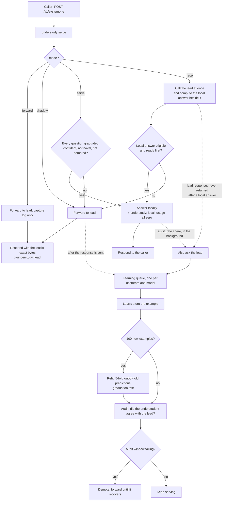
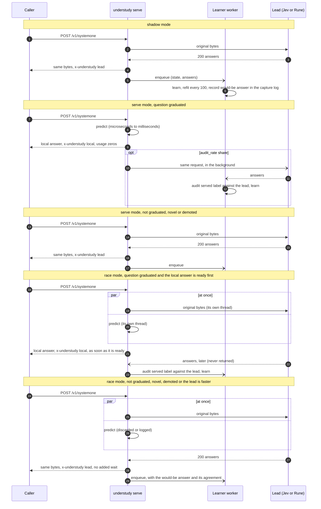
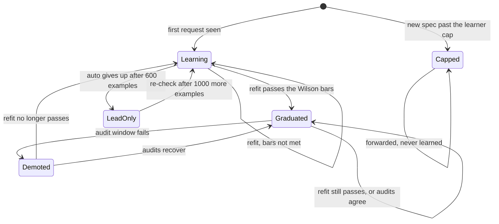
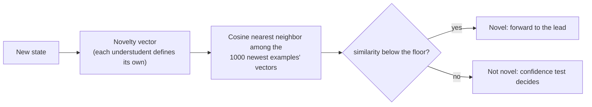
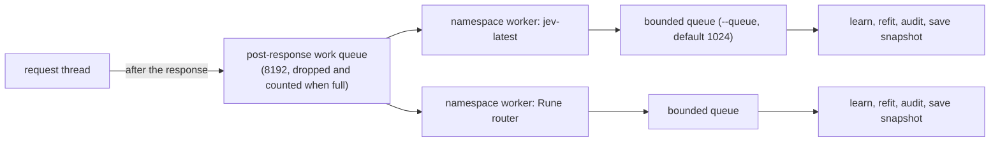
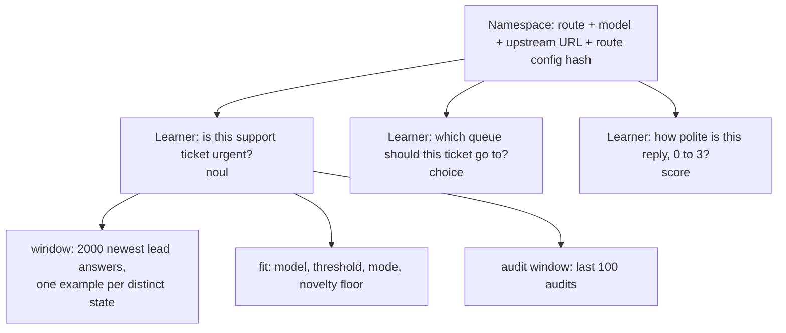

# How it works

Understudy sits in front of a lead decision model (Jev, Rune, or anything that speaks `POST /v1/systemone`). The caller
changes only its base URL. For every distinct question the caller asks, Understudy keeps a small CPU model, the
*understudent*, trains it on the lead's answers, and lets it answer locally only after statistics say it agrees with the
lead often enough. Everything else goes to the lead, unchanged.

- [Request flow](#request-flow)
- [Shadow versus serve](#shadow-versus-serve-versus-race)
- [Question lifecycle](#question-lifecycle)
- [Novelty forwarding](#novelty-forwarding)
- [Learning queue](#learning-queue)
- [Namespaces and learners](#namespaces-and-learners)
- [Scope](#scope)

Related pages: [graduation](graduation.md) (the statistics), [understudents](understudents/README.md) (the designs that
race per question), [api](api.md) (the wire contract), [examples](examples.md).

## Request flow

One request can carry several questions about one state. A question is identified by its *spec* (type, instructions,
criteria), not by its name, so two callers asking the same thing share one learner.

Points worth knowing:

- **Forwarding is transparent.** The original request bytes go to the lead once. The lead's status, body and
  `Retry-After` come back unchanged, including errors. The caller owns retries and deadlines.
- **Learning is off the hot path.** The response is on the wire before any learning, refit or audit work starts.
- **All or nothing per request.** In `serve` mode a request is answered locally only if *every* question in it may be.
  Otherwise the whole request is forwarded. Mixed local and lead answers are never produced.
- **Audits check agreement.** About one local answer in ten (`--audit-rate`, default 0.1) is also sent to the lead in the
  background. The comparison feeds the audit window, so a drifting understudent gets demoted. Those background calls are
  the only lead cost a graduated question still pays. Every other local answer is a lead call never made, so savings
  scale linearly with call volume while the understudent's own cost is CPU time (see
  [Cost at scale](benchmarks.md#cost-at-scale)).

## Shadow versus serve versus race

`shadow` is the safe way to start: the caller always gets the lead's answer, and Understudy records what it *would*
have said. `serve` is the same pipeline with the local-answer branch switched on. `race` is `serve` with the lead call
started first: it never makes a forwarded request wait for the local computation.

| | `forward` | `shadow` (default) | `serve` | `race` |
|---|---|---|---|---|
| Caller gets | the lead's response | the lead's response | local answer when every question may answer, else the lead's response | the first usable result: a local answer if it is eligible and ready first, else the lead's response |
| Learns | no | yes | yes (from forwards and audits) | yes (from every lead response, which is also the audit) |
| Capture log | yes | yes, with the understudent's would-be answer | yes | yes, with `local_ms`, `lead_ms` and the audit's agreement |
| Added latency | pass-through | about 0.3 ms at p50 | a prediction on the local path; about 0.3 ms plus the prediction when it forwards | the local path's prediction only; about 0.3 ms when it forwards, whatever the prediction costs |
| Lead calls saved | none | none | the graduated share, minus the audit share | none (every request is audited); it buys latency |

## Question lifecycle

Every question, per namespace, is in one of these states. The `/status` endpoint reports `learning`, `graduated`,
`demoted` or `lead_only`.

Notes on the diagram:

- **Learning**: every request is forwarded and becomes an example. The question has no graduated mode yet, or has too
  few examples (the minimum is 60) or only one answer seen so far.
- **Graduated**: a refit found a confidence threshold at which the understudent's out-of-fold predictions clear the bars
  (see [graduation](graduation.md)). In `serve` mode, a request the understudent is confident about and not novel on is
  answered locally.
- **Demoted**: the audit window says the understudent is no longer as good as the bar. It forwards everything again, but
  keeps being audited whenever it would have answered, so it can recover. A refit that no longer graduates sends the
  question back to learning.
- **Lead-only** (the `auto` understudent only): after 600 examples with no candidate graduating and none within 0.05 of
  the target, the question forwards immediately without computing any features. It re-checks every 1,000 new examples.
  Broad questions over huge state spaces end up here. The cost is the forwarding overhead and nothing else.
- **Capped**: the namespace or learner cap was reached, so a new question spec is forwarded and never learned. It is
  not a state a learner moves into (no learner exists); it is shown because those requests also never graduate and
  are counted in `/status`. See [api](api.md#limits).

## Novelty forwarding

A graduated understudent is a statement about inputs *like the ones it was trained on*. Before answering locally it checks
that the state is not an outlier.

The floor is the 5th percentile of the training examples' own nearest-neighbor similarities, recomputed at every refit.
So about one in twenty typical training states would count as novel, and a state that looks unlike anything seen
is forwarded however confident the model is. Novel states are not wasted: they are forwarded, answered by the lead and
learned from, so the neighborhood fills in. `memo` has no novelty vector (it only answers near-duplicates) and
`rules` has none either.

## Learning queue

- A request thread parses the body, forwards, answers the client, and *then* hands the rest to helper threads.
- Each upstream and model namespace has one worker that owns its learners. It learns, refits, audits and saves the snapshot
  (every `--save-every` learned requests, at shutdown, and when idle).
- The queue is bounded (`--queue`, default 1024 per namespace). When it is full the job is dropped and counted
  (`learn_dropped` in `/status`), never waited for. A refit therefore stalls neither responses nor other namespaces.
- In `serve` mode a request waits at most `--local-wait-ms` (default 5 ms) for the namespace lock. If a refit holds it
  longer, the request is forwarded (counted as `local_busy`).

## Namespaces and learners

A **namespace** is one upstream plus one model, for example Rune's router model or `jev-latest`. It owns a worker, a
snapshot directory and a set of learners. Models never share a learner: `jev-latest` and `jev-preview` learn separately,
because their answers can legitimately differ.

A **learner** is one question spec within a namespace. Its identity is the hash of the question's type, instructions and
criteria (criteria order does not matter). The caller's question *names* are not part of it, so two different names with
identical specs share a learner, and the response's `answers` keys always equal the submitted names.

A namespace is created only after a successful 2xx upstream answer with an `answers` object for that model, so garbage
requests and failed calls never create state. `--max-namespaces` (default 16) and `--max-learners` per namespace
(default 256) bound the memory; past a cap a request is forward-only and counted. A saved snapshot records the upstream and
its configuration, and a snapshot whose recorded upstream differs is refused with a clear error instead of being reused.

## Scope

Understudy helps where a question is **narrow and repetitive**: the same yes/no gate, classification, routing,
triage, moderation, relevance or judging question asked over and over about states that look alike. The model has
a bounded job and can learn it from a few hundred answers.

It does not help when the decision **compares two changing texts** (a fresh query against a fresh passage, as in search
relevance or reranking): there is no fixed question to learn, and these small models stay lead-only on it.

It does not help on **broad single-question decisions over huge state spaces**, such as choosing a move in a game. Each
state is different and the answer depends on deep reasoning, so no cheap model reaches the bar. Those questions never
graduate, and with `auto` they are marked lead-only after 600 examples. They cost the forwarding overhead
(about 0.3 ms per call) and nothing else. See [examples](examples.md#b-a-broad-question-stays-lead-only).

## Before pointing a caller at it

Understudy is meant to be a drop-in: swapping it in is a base-URL change, and a caller that works against the lead keeps
working. [api.md](api.md) has the exact contract (request and response shapes, errors, headers). The rules behind it:

- **Whole-request forwarding.** A request is forwarded byte for byte, or answered locally in full. Mixed per-question routing
  inside one request is not done, so usage and error semantics stay the lead's.
- **Errors are the lead's.** Upstream statuses, bodies and `Retry-After` pass through unchanged; an error is never turned into
  a 200 or a fallback answer, and the proxy does not retry, because callers already retry and nested retries can overrun
  their deadlines.
- **Unknown fields are forwarded.** Fields and question types Understudy does not understand stay forwardable rather than
  blocking an otherwise valid request.
- **No global locks across the lead.** Concurrent callers are served without holding a learner lock across an upstream
  request or a refit; training state is isolated by route, model and question identity.

Validate before promotion. Start in `shadow` (the default), where every request is forwarded and the capture log records what
would have been answered locally, and promote to `serve` only when the log agrees with the lead. Replay a fixture of your own
traffic against a fake upstream and check:

- several questions per request, including identical specs under different names, and criteria that change order or use
  Unicode labels;
- choice-only and probability-bearing responses;
- each upstream error class: 400, 402, 413, 422, 429 and 503 (both `Retry-After` forms), other 5xx, a malformed JSON body and a
  transport failure;
- unknown request and response fields, and unsupported question types;
- concurrent callers during refits, with bounded queues;
- forwarded response bytes equal to the lead's, and a local answer your client decodes successfully.

Measure how often your questions repeat before expecting coverage: a caller whose instructions or option sets change on every
call makes a new question each time, and a new question never graduates.
