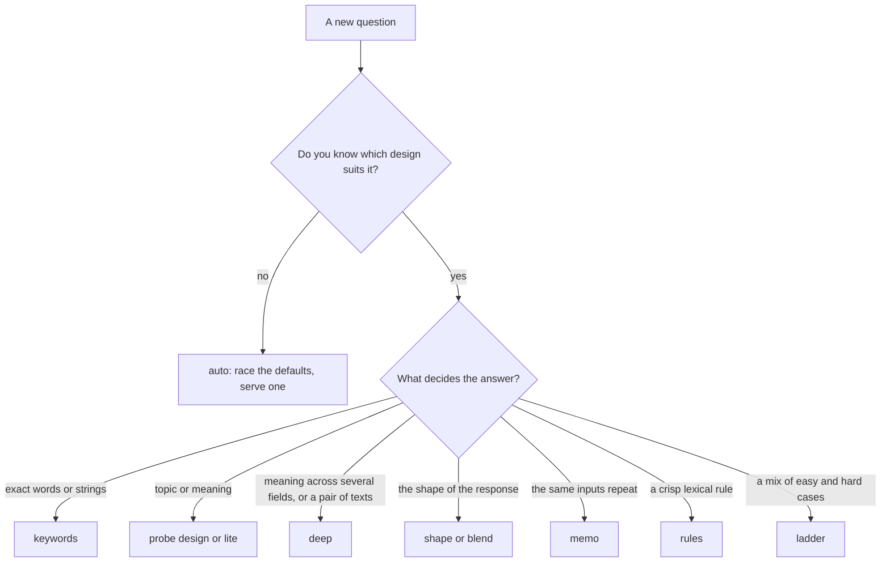

# Understudent designs

An *understudent* is the small CPU model that learns one question from the lead's answers. All designs run under the
same routing and statistics: 5-fold out-of-fold predictions, Wilson-bound [graduation](../graduation.md), novelty
forwarding, audits and demotion. A design supplies only **features**, a **fit**, a **prediction** and a **novelty
vector**. Pick one with `--understudent NAME` (default `deep`), or race several per question with [auto](auto.md).

Worked-example numbers on each page are illustrative unless a page says it cites a committed run.

## Comparison

| design | reads | model | encoder | typical cost | novelty vector | best at | in default `ladder` / `auto` |
|---|---|---|---|---|---|---|---|
| [lite](lite.md) | input token embeddings, mean and max | standardized LR | table only, no layer | ~0.1 to 0.5 ms | mean of embeddings | topic, keywords | yes |
| [keywords](keywords.md) | hashed char 3-5-grams and word 1-2-grams | sparse LR, C = 30 | none | ~0.05 to 0.3 ms | 256-d projection | surface strings, templated text | yes |
| [probe](probe.md) | layer-8 token mean | standardized LR, C = 0.5 | layers 0 to 8 | ~20 to 100 ms | layer-8 mean | topic, tone, paraphrase | yes |
| [deep](deep.md) | per-token states, layers 4, 8, 12 | pool LR or attention head | layers 0 to 12 | ~35 to 230 ms | layer-8 mean | kind, pairs, gates | yes |
| [neighbors](neighbors.md) | layer-8 mean | cosine 7-NN vote | layers 0 to 8 | ~20 to 100 ms | same vector | clustered inputs | no (not a tier) |
| [shape](shape.md) | 430 structural features | standardized LR | none | ~0.03 to 0.5 ms | standardized vector | response shape, refusals | opt-in |
| [blend](blend.md) | n-grams + shape + input embeddings | one sparse+dense LR | table only | ~0.03 to 0.5 ms | n-gram projection | mixed signals | opt-in |
| [memo](memo.md) | text hash + MinHash of char 5-grams | retrieval of past answers | none | microseconds | none | repeats and near-duplicates | opt-in |
| [rules](rules.md) | LLM-written regexes | first matching rule | none | microseconds | none | crisp lexical rules | opt-in, first tier only |
| [ladder](ladder.md) | each tier's own | one fit per tier | up to the answering tier | the answering tier's | each tier's own | mixed easy and hard | (it is the ladder) |
| [auto](auto.md) | each candidate's own | a race, one served | only the serving candidate's | the serving candidate's | the serving candidate's | unknown or shifting questions | (it is the race) |

Costs are per item on CPU, order of magnitude, from the committed replays in `runs/v1-target97` (keywords, lite, `probe`, deep,
neighbors) and from validation notes for shape, blend and memo. The `readout` field of a decision names what answered: `pool`,
`attn`, `mean`, `lite`, `neighbors`, `keywords`, `shape`, `blend`, `memo`, `rules`, or a ladder's tier (`deep:pool`).

## Selection

When in doubt, use `auto`: it spends a little more while learning and then serves the best design per question.
