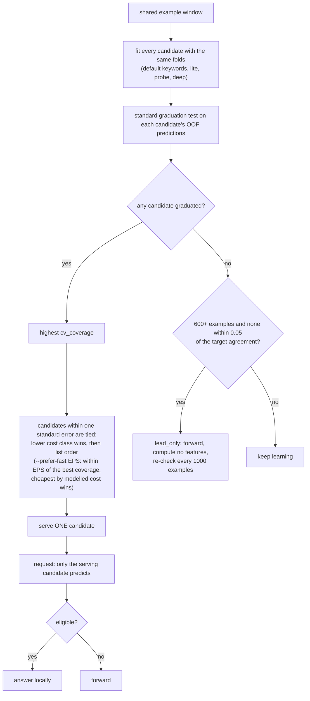
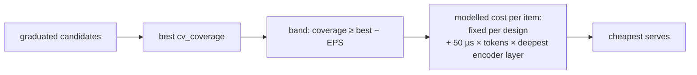

# auto

**Race the candidates, then serve exactly one.** `auto` fits every candidate design on the same examples at every refit,
runs the standard graduation test on each, and picks the single best one to answer. It also notices questions that no
cheap design can learn and marks them lead-only.

## Pipeline

## Race

- **Candidates:** `--candidates`, default `keywords,lite,probe,deep`. Any of `rules` (first only), `keywords`, `lite`, `probe`,
  `deep`, `shape`, `blend`, `memo`.
- **Serving candidate:** among the graduating ones, the highest `cv_coverage`. Candidates within **one standard error**
  of that coverage (`sqrt(c(1−c)/n)`, `n` = rows fitted) are tied, and the one with the lower *cost class* wins, then
  the earlier in the list (cheapest first). Cost is the candidate's measured encode time plus prediction time, compared by
  decade of microseconds so timing noise cannot flip a choice and a replay repeats.
- **`--prefer-fast`:** see [below](#prefer-fast).
- **Rules in the race:** the evaluation rows for `rules` are its held-out rows, so the tie band uses the smallest evaluation
  set among the graduated candidates.
- **Only the server answers and is audited.** Switching serving candidate (including to none) clears the audit windows
  involved. Each refit records the race (per candidate: `cv_agreement`, `cv_coverage`, `mode`, `why_not`, `cost_us`) in
  the snapshot, in `understudy status`, and in the replay summary (`candidates`, `serving`, `serving_history`, `lead_only`).

## Prefer fast

`--prefer-fast EPS` (default off, and then nothing above changes) trades a little coverage for latency. Among the candidates
that graduated, those whose `cv_coverage` is within EPS (absolute, for example `0.05`) of the best form a band, and the
cheapest one by **modelled** cost serves (then the earlier in the list). Every candidate in the band has met the agreement
and minority bars on its own out-of-fold predictions, so only coverage is traded, never the agreement bar. A design whose
coverage is further than EPS below the best is never chosen, however cheap.

The cost is **not measured**. It is a recorded model of the design, the deepest encoder layer it runs, and the mean token
count of recent examples, so a replay repeats and a timing glitch cannot flip a choice. The cheap designs cost a fixed
80 to 350 µs, `probe` about 200 µs plus 50 µs per token per layer over 8 layers, `deep` about 400 µs plus the same over 12
layers (see [SPEC.md](../../SPEC.md) for every constant). A race record's `cost_us` holds the modelled cost while the flag
is on.

Results (cold-start replay, Jev, `runs/pf-off-*` against `runs/pf-on-*`, `--prefer-fast 0.05`):

| dataset | `--prefer-fast` | serving (from item) | coverage | agreement (Wilson low) | answered p50 | answered p95 |
|---|---|---|---|---|---|---|
| politer_reply | off | keywords@100 | 80.0% | 94.2% (91.7) | 0.23 ms | 0.39 ms |
| politer_reply | 0.05 | keywords@100 | 80.0% | 94.2% (91.7) | 0.23 ms | 0.41 ms |
| output_kind | off | keywords@100 > deep@285 | 55.2% | 98.5% (96.5) | 39.8 ms | 267.6 ms |
| output_kind | 0.05 | keywords@100 > deep@285 | 55.2% | 98.5% (96.5) | 38.3 ms | 238.1 ms |
| tool_failed | off | deep@400 | 25.3% | 98.0% (94.4) | 70.0 ms | 255.7 ms |
| tool_failed | 0.05 | deep@400 | 25.3% | 98.0% (94.4) | 81.0 ms | 276.5 ms |
| output_kind | 0.12 | keywords@100 > deep@285 > keywords@579 | 54.8% | 98.5% (96.5) | 32.1 ms | 232.0 ms |
| tool_failed | 0.12 | `probe`@400 | 21.8% | 96.9% (92.4) | 52.2 ms | 197.6 ms |

At **0.05 the serving choice is identical on all three datasets**: the decisions, coverage, and agreement are the same, and
the latency differences in the rows (for example tool_failed 70 against 81 ms with the same deep serving) are run-to-run
timing noise, about 15% on this machine. The margin is too tight to matter here: the coverage gaps between the cheap and the
expensive designs are 0.108 on output_kind (keywords 0.663 against deep 0.770) and on tool_failed (`probe` 0.718 against deep 0.825),
just outside 0.05, and politer_reply is already served by keywords. A wider margin shows the mechanism: at 0.12, tool_failed serves `probe` (answered p50 52 against 70 ms, 3.5 points less
coverage, agreement 96.9% against 98.0%, Wilson low 92.4 against 94.4, both over the 0.90 bar) and output_kind ends on keywords
(which only happens at its last refit, item 579, so the run barely changes). Choose EPS from the coverage you can give up; the
agreement bars are met either way. The cold-start replay takes a refit cadence of 100 examples, so most of a run is spent
learning and a switch comes late.

## Lead-only verdict

After `--give-up-after` examples (default 600) with **no** candidate graduated and **none within 0.05** of `--target` in
`cv_agreement`, the question is `lead_only`. It forwards at once, computes no features (the states are kept and encoded at
the re-check), and refits only every 1,000 new examples, which can lift the verdict. This is how a broad question over a
huge state space ends up costing only the forwarding overhead. See
[examples](../examples.md#b-a-broad-question-stays-lead-only).

## Lazy features

A local prediction computes only the serving candidate's features, so a serving `keywords` never runs the encoder. A forwarded
item and an audited local item compute every candidate's features, since each becomes a training example for all of them.
So an `auto` question pays for all candidates while learning and only for the serving one afterwards. Examples made while
lead-only (or loaded from an old snapshot) sit out a refit until they are encoded.

## Strengths and weaknesses

- Good: when you do not know which design suits a question, or the answer changes over time. It avoids the ladder's
  error compounding by serving one design, and it gives up cheaply on questions that cannot be learned.
- Bad: the learning phase pays for every candidate, and it only ever serves one design, so a ladder's "easy ones by
  keywords, hard ones by deep" mix is not available.

## Cost and latency

Learning: the sum of the candidates' feature costs per example. Serving: the serving candidate's alone. Lead-only: nothing
beyond forwarding (about 0.3 ms).

## Snapshot contents

One fit per candidate (`fits/<key>.<candidate>.safetensors`), the race record, `serving_idx`, the lead-only reason, and the
raw states kept while lead-only.

## Worked example (illustrative numbers)

Question: "Does this passage mention a refund?" At the refit with `n = 300` examples the race shows: keywords not
graduated, lite `cv_coverage` 0.31, `probe` 0.53, deep 0.55.

- Best coverage is deep's 0.55. The standard error is `sqrt(0.55 × 0.45 / 300) = 0.029`, so candidates at or above
  0.521 are tied: `probe` (0.53) and deep. lite (0.31) is out.
- Cost class decides the tie. `probe` costs about 30 ms per item (`floor(log10(30,000 µs)) = 4`), deep about 100 ms
  (`floor(log10(100,000 µs)) = 5`), so `probe` wins.
- `serving` is `probe`. If a later refit gives deep 0.70 and `probe` 0.55, `probe` falls below the band
  (0.70 − 0.026 = 0.674), so serving switches to deep and both audit windows are cleared.
