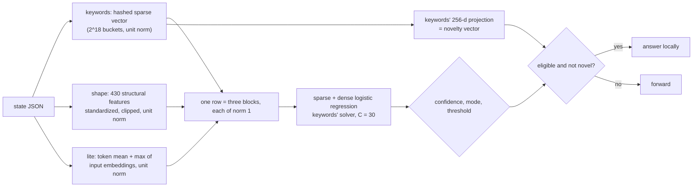

# blend

One model over the **cheap features together**: hashed n-grams, structural features and the input embedding means. It
tries to get most of the way to a neural readout without running a transformer layer.

## Pipeline

## Features, model and confidence

- **Row:** `[keywords' hashed, L2-normalized sparse vector] ++ [shape's features, standardized, clipped, normalized to unit L2
  per row] ++ [lite's mean+max embedding pools (pairs: the four-way pair features), standardized, clipped, unit L2]`.
  Each block has norm exactly 1 (0 for an all-zero block), whatever outliers clipping lets through.
- **Model:** the dense blocks are extra columns after the 2^18 buckets of the sparse solver, with `keywords`'s `C = 30`,
  minimum document frequency 2 and L-BFGS settings.
- **Per fold:** each CV fold's two standardizers are fitted on that fold's training rows only.
- **Novelty vector:** `keywords`'s projected vector.

## Strengths and weaknesses

- Good: questions where the signal is a mixture, some wording, some shape, some topic. One model weighs them jointly.
- Bad: it inherits each block's blind spots (no context, no word order beyond bigrams). Only the embedding table is read,
  so it is cheap, but its gain over the best single cheap design is modest and question-dependent.

## Cost and latency

Hundreds of microseconds per item (about 30 to 500 µs of overhead), no transformer layer. In a race, a state computes each
input once: `blend` shares the embedding slot with `lite` and its sparse vector with `keywords`. Opt-in.

## Snapshot contents

`fits/<key>.safetensors`: `sparse.{coef,intercept}` over all stacked columns, `blend.shape_mu`, `blend.shape_sd` and the
embedding standardizer, and `refs`. States hold the sparse vector, `shape.v` and the lite pools.

## Worked example

Question: "Is this support message angry?" Wording ("unacceptable", "!!!") is an n-gram signal, ALL CAPS and exclamation
shares are structural signals, and the overall topic is an embedding signal. None alone clears the bar; the joint
model's OOF agreement reaches 0.93 at confidence 0.80 over 60% of rows, so it graduates where the single cheap designs
did not.
