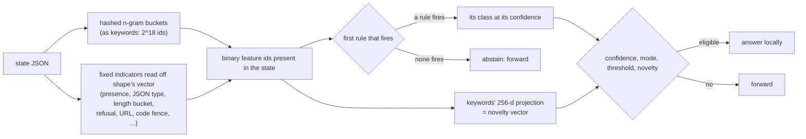

# checklist

An ordered decision list of one-feature rules (`IF feature THEN class`), learned greedily from the lead's answers. **No
encoder and no model file.** The understudent answers only when a rule fires and abstains otherwise, so every answer it
gives can be traced to one printed rule.

## Pipeline



## Features, model and confidence

- **Features:** each feature is present or absent. Every hashed n-gram bucket that [keywords](keywords.md) produces for the
  state is a feature (ids `0` to `2^18 - 1`). On top of those sits a fixed catalogue of indicators (about 440) derived
  from [shape](shape.md)'s structural vector with fixed thresholds, so nothing is fitted and nothing leaks. Per field
  slot: the presence bit, the JSON type, a true boolean, a positive or negative number. For each field's text and for the
  whole state's text: a length bucket (up to 10, 11 to 50, 51 to 200, 201 to 1,000, over 1,000 characters), multiple
  lines, markdown headers, bullets, code fences, URLs, question marks, numbers, refusal, apology and hedging markers, an
  echoed number, mostly digits, mostly uppercase.
- **Induction:** greedy sequential covering, CN2/RIPPER style, with one-literal rules. Among the training rows no earlier
  rule took, pick the (feature, class) pair with the highest Wilson lower bound of precision (ties: more rows, then the
  lower feature id, then the lower class). Only features present in at least 5 training rows are candidates. Keep the rule
  if its bound is at least 0.6 and it covers at least 5 of the remaining rows. Remove the rows it covers and repeat, up to
  40 rules. Rules therefore come ordered by precision on the rows left to them.
- **Confidence:** the Laplace-smoothed precision `(hits + 1) / (rows + 2)` on the rows the rule took. The rest of the
  probability is spread evenly over the other classes.
- **Abstention:** the prediction is the first firing rule's class. When no rule fires there is no prediction and the
  request is forwarded. The default class (the majority of the rows no rule covers) is reported in the listing but never
  answers.
- **Out-of-fold:** each fold's list is induced on that fold's training rows. A held-out row that no rule fires on is an
  abstention, neither agreement nor disagreement. Graduation is the shared Wilson scan over the rows the design answers,
  and `cv_agreement` is computed over those rows (0.0 below 30 answered rows).
- **Novelty vector:** the same 256-d projection as keywords.

## Rule listing

The fit report and `understudy status` print one rule per line:

```text
1. IF [answer].refusal THEN yes   [conf 0.974, 41/42 rows]
```

A hashed n-gram prints as its text (the most frequent n-gram in the bucket, annotated `(+N colliding)` when several
share it), or as `gram#<bucket>` when the training texts are unknown. The texts are kept in memory by a running proxy and
are never saved in a snapshot. A structural indicator prints as the field that most often holds it, else `slotN.name`;
the whole-state block prints as `all.*`. The listing is saved in the snapshot's fit report, so it survives a reload.

## Strengths and weaknesses

- Good: an auditable policy. Each answer maps to one rule with its confidence and row counts, so a reviewer can read what
  the design learned and see when a rule is a spurious n-gram.
- Good: answers only where a rule is precise, and needs no encoder, so it works before the model is downloaded.
- Bad: one literal per rule. It cannot express a conjunction, a count or a paraphrase, and a question decided by several
  weak signals yields no rule that reaches the 0.6 bound.
- Bad: coverage is limited to what the rules take. Inputs no rule matches are forwarded for good, so coverage tends to
  trail [keywords](keywords.md) and [deep](deep.md).
- Opt-in: it is not in the default `ladder` or `auto` candidates. Add it with `--candidates` or `--tiers`.

## Cost and latency

A 600 to 2,000 example refit took 0.3 to 0.7 s on a loaded 8-core machine (SPEC.md). It is on the cheap refit schedule.
Latency in the committed idle-machine run `runs/latencyd-jev` (see [Latency](../benchmarks.md#latency)):

| | answers locally, p50 / p99 | own time on a forwarded call, p50 / p99 |
|---|---|---|
| checklist | 0.15 to 0.24 / 0.6 to 0.7 ms | 0.10 to 0.19 / 0.5 to 0.6 ms |

The auto race models its cost at 170 µs per item for `--prefer-fast`.

## Measured results

From `runs/latencyd-jev` (lead answers recorded, 600 items per set, graduated on the first 200):

| set | coverage | agreement with the lead on local answers | local answers |
|---|---|---|---|
| politer_reply | 60.2% | 97.5% | 361 |
| output_kind | 21.2% | 95.3% | 127 |

On the same runs keywords covers 80.0% and 51.7%. On the three sets of the wave-2 validation in
[SPEC.md](../../SPEC.md#wave-2-validation-net-checklist---abstain-calibrated) it covered 0.0% under the default policy,
and no question was won by it there.

## Settings

Select it with `--understudent checklist`, as a `--tiers` entry, or in `--candidates`. The constants `MAX_RULES = 40`,
`MIN_SUPPORT = 5`, `MIN_RULE_LB = 0.6` and `MIN_DF = 5` are fixed in `src/checklist.rs`. Graduation, thresholds, audits
and demotion are the shared settings ([graduation](../graduation.md)).

## Snapshot contents

The rules (feature id, class, confidence, rows, hits), the default class and the rule names are stored with the fit.

See also [keywords](keywords.md), [shape](shape.md) and [rules](rules.md), which also answer from lexical or structural signals.
