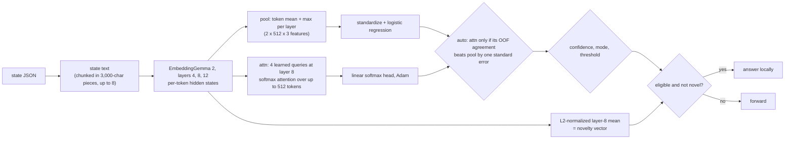

# deep

The richest design and the default `--understudent`. It reads **per-token** hidden states from three layers of
EmbeddingGemma 2 and learns how to pool them: mean and max pooling, or a learned attention pooling, chosen per question
by cross-validation.

## Pipeline

## Features, model and confidence

- **Encoder:** layers `[4, 8, 12]` (`--layers`). A text over 3,000 characters is split into consecutive chunks of at most
  3,000 characters, each cut after the last line break in the final 30% of its window, at most 8 chunks. Token mean is
  the token-weighted mean across chunks, token max is the max, and the attention readout keeps at most 512 tokens
  (each chunk keeps its fair share, head and tail). `--no-chunk` clips instead, like [probe](probe.md).
- **pool readout:** per layer, token mean and token max, concatenated, standardized, then a weighted L2 logistic
  regression. Cheap.
- **attn readout:** on one layer (`--attn-layer`, default the middle one), `K = 4` learned query vectors each pool the
  tokens by softmax attention. The four pooled vectors plus the token mean feed a linear softmax head, trained with Adam on
  weighted cross-entropy plus L2, for 8 to 40 epochs (about 16,000 example passes), seeded.
- **pair:** a question with `pair` fields embeds each separately and uses `[x, y, x − y, x ⊙ y]` of the pooled features.
- **auto readout** (default): fit both with the same folds and pick **attn** only if its OOF agreement exceeds pool's by
  more than one standard error; otherwise the cheaper pool. Graduation uses the chosen readout's OOF predictions.
- **Novelty vector:** the L2-normalized combined token mean at the middle layer.

## Strengths and weaknesses

- Good: topic or kind of output, pair comparison, error detection, and yes/no gates over several fields (best coverage on most of the synthetic sets where anything graduates). It is the
  design that most often covers questions the cheaper ones cannot.
- Bad: the slowest to fit and to run, and the most data-hungry (the attention head). It can lean on shortcuts: a cue that
  holds in the examples it saw (response length, say) but not on live traffic. Audits catch that and demote it.
  Questions that compare two changing texts, such as a fresh query against a fresh passage, stay lead-only.

## Cost and latency

The full encoder to layer 12: tens to hundreds of milliseconds per item on CPU (about 35 to 230 ms in the committed
replay in `runs/v1-target97`). Training the attention head adds seconds per refit at 2,000 examples. In a ladder or an
`auto` race, deep is the last resort that only runs when cheaper tiers cannot answer.

## Snapshot contents

`fits/<key>.safetensors`: `pool.{mu,sd,coef,intercept}`, `attn.{mu,sd,q,w,b}`, and `refs`. `states/<enc>.safetensors`: per
state `part<i>.pool` (F32 pooled features) and `part<i>.tokens` (BF16 token states `[t, 512]`, at most 512 tokens).
Token states are what let a refit retrain the attention head without re-encoding.

## Worked example

Question: "Does this tool output contain a failure?" (noul) over outputs hundreds of lines long where the failing
line is buried. Mean pooling dilutes the one `FAILED` line among 400 lines of passing logs, so pool's OOF agreement is
0.86. The attention head learns to put weight on tokens near `FAILED` and `error:`, reaching 0.93. That is more than
one standard error above pool's, so `auto` picks **attn**; the decision's `readout` is reported as `attn`.
