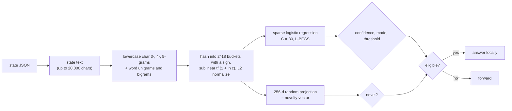

# keywords

Hashed character and word n-grams into a sparse logistic regression. **No neural network and no model file**: the encoder
is never loaded, so it is the cheapest design that still reads the text.

## Pipeline

## Features, model and confidence

- **Features:** lowercase character 3-, 4-, and 5-grams and word (alphanumeric run) unigrams and bigrams, hashed with FNV-1a
  and a splitmix finalizer into 2^18 buckets; each distinct feature's count gets sublinear tf (`1 + ln c`), signed values
  accumulate per bucket, and the vector is L2-normalized. A `pair` hashes each field into its own namespace and adds the
  signed difference of the two fields' features in a third (a feature both share cancels; swapping the fields negates it).
- **Model:** weighted L2 logistic regression on the sparse vectors, `C = 30` (L2-normalized inputs need far more than
  `C = 0.5`). Buckets seen in fewer than 2 training rows are fixed at zero. L-BFGS to a max gradient of 1e-3, 300
  iterations at most. The fit and its five folds run in parallel.
- **Novelty vector:** a fixed sparse random projection of the hashed vector to 256 dimensions (each bucket adds ± its
  value to 4 hashed dims), L2-normalized, so nearest-neighbor cosine approximates the sparse cosine at a fixed cost.

## Strengths and weaknesses

- Good: surface properties and templated text: error messages, status codes, markers like "exit code 1", shouting,
  specific phrases. It often wins on gates whose answer is visible on the surface of the output.
- Good: tiny cost, so it graduates early and keeps learning on the cheap schedule.
- Bad: paraphrase and meaning. It sees characters and words, not what they imply. Long texts where the signal is one
  line buried in noise dilute the weights.

## Cost and latency

About 40 to 330 µs per item in the committed replay (`runs/v1-target97`). A 2,000-example refit takes about 0.15 s on
~150-character texts and 0.9 s on 2,400-character ones. No model is loaded at all.

## Snapshot contents

`fits/<key>.safetensors`: `sparse.{coef,intercept}` and `refs`. `states/<enc>.safetensors`: `sparse.idx` (U32) and
`sparse.val` (F32) per encoded state.

## Worked example

Question: "Is this tool output an error?" Training states include `Traceback (most recent call last):`, `exit code 1`, and
`permission denied` labeled "yes", and `ok`, `exit code 0`, and `3 files changed` labeled "no". The n-gram `exit code 1`
and `traceback` get large weights. A new output `Error: ENOENT: no such file` gets `p_yes = 0.97` and is answered
locally in about 0.15 ms. A decoy `Wrote a section titled "Error handling" to README.md` is a decoy for a bag of words;
if the lead called such decoys "no" often enough, the model learns that `wrote` and `readme` pull towards "no", and the
audit window catches the cases where it still gets them wrong.

See also [lite](lite.md), [shape](shape.md), and [blend](blend.md), which add structure or meaning.
