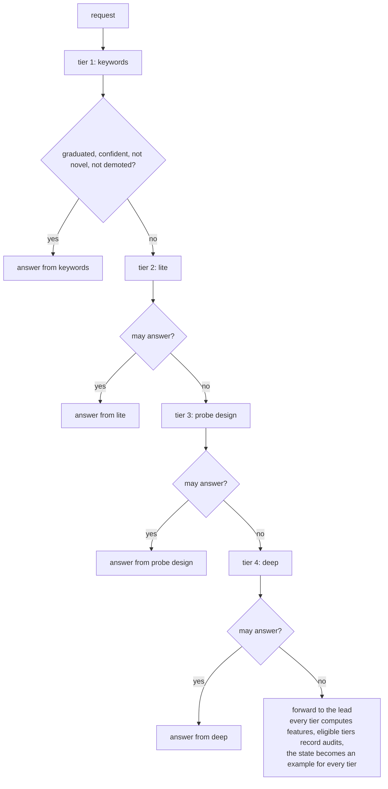

# ladder

Several understudents stacked **cheapest first**. Each tier is a complete understudent with its own fit, graduation, audits and
demotion, and the cheapest tier that may answer, answers.

## Pipeline

## How it routes

- **Tiers:** `--tiers`, default `keywords,lite,probe,deep`. Any of `rules` (first only), `keywords`, `lite`, `probe`, `deep`, `shape`,
  `blend`, `memo`, each at most once, cheapest first.
- **Features are lazy.** A tier's features are computed only when a request reaches it: `keywords` needs no model, `lite`
  only the embedding table, `probe` layers 0 to 8, `deep` up to layer 12. A learning tier costs a prediction, not a skipped
  forward.
- **Shared encoder pass.** `probe` and deep share one forward pass when their texts agree (states under 3,000 characters):
  `probe`'s pass keeps its partial state and deep resumes it to layer 12.
- **Forwards audit everyone.** When no tier may answer, the lead is called, every tier with a model predicts, and each tier
  that was eligible (including a demoted one) records an audit. A local answer is audited at `--audit-rate`: the
  answering tier, and any other tier whose prediction was already computed, record audits.
- **Demoted tiers are skipped,** so their answers go to the next tier, but they keep getting audits when reached.
- **Refits:** all tiers refit every 100 examples, and the cheap tiers (`keywords`, `lite`, `rules`, `shape`, `blend`, `memo`) also
  every 25. That is what lets a cheap tier keep learning, and take over, after a stronger tier started answering and
  slowed the arrival of examples.
- **Reporting:** a decision's `readout` names the answering tier (`keywords`, `lite`, `mean` for `probe`, `deep:pool`,
  `deep:attn`). The replay summary adds `coverage_by_tier`, `graduated_at_item_by_tier` and per-tier refit seconds.

## Strengths and weaknesses

- Good: workloads that mix easy and hard instances of one question. Surface-obvious states are answered in microseconds;
  harder ones climb until a tier is confident.
- Bad: **error compounding.** Each tier's mistakes add up, so a ladder can end up worse than its best tier alone. Where
  you want one best-covering design, use [auto](auto.md). A forwarded request also pays for every tier's features.

## Cost and latency

Depends on which tier answers: microseconds for keywords, hundreds of microseconds for lite, tens of milliseconds for
`probe` and deep. A forwarded item computes every tier (so it costs the most), which is overhead in front of the lead's own
latency.

## Snapshot contents

One fit per tier: `fits/<key>.<tier>.safetensors`. States additionally hold `mean<i>.pool` (`probe` design) and `stat<i>.pool`
(lite) next to deep's parts and the sparse vector, so refits never re-encode.

## Worked example

Question: "Is this tool output an error?" A request reaches `keywords` first. For `Traceback (most recent call last)` keywords
is confident at 0.97, graduated and not novel: it answers, and lite, `probe` and deep never run. For a polite paraphrase
of a failure, the `keywords` design's confidence is 0.62, under its 0.86 threshold, so the request reaches `lite`, then `probe`, where
confidence 0.91 clears `probe`'s 0.88 threshold and `probe` answers. If even deep cannot, the lead is called, and all four
tiers learn from its answer.
