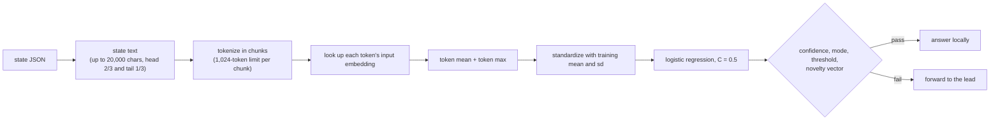

# lite

The cheapest neural design. It reads the encoder's **input token-embedding table**: no transformer layer ever runs, so
featurizing a state is a tokenizer pass and table lookups.

## Pipeline

## Features, model and confidence

- **Features:** the token mean and token max of the input embeddings, concatenated. A question with a `pair` of fields
  pools each field separately and uses `[x, y, x − y, x ⊙ y]`.
- **Model:** standardized, L2-regularised weighted logistic regression (`C = 0.5`). The confidence is the highest
  class probability. Graduation is the shared [Wilson test](../graduation.md).
- **Novelty vector:** the L2-normalized mean of the embeddings.

## Strengths and weaknesses

- Good: questions where *which words appear* decides the answer: topic, language, presence of a keyword family,
  "is this a refund request".
- Bad: anything where word order or context matters ("not urgent" versus "urgent"), because the table has no context.
  It also cannot read a needle buried in a long text any better than a bag of words can.

## Cost and latency

Microseconds to a few hundred microseconds per item (about 90 to 530 µs in the committed replay in
`runs/v1-target97`), no model layers, CPU only. Refits on a 2,000-example window are fast. In a ladder it is on the
cheap refit schedule (every 25 examples).

## Snapshot contents

`fits/<key>.safetensors`: `pool.{mu,sd,coef,intercept}` and `refs` (novelty vectors). `states/<enc>.safetensors`: the
pooled mean and max per encoded state (`stat<i>.pool` in a ladder). No token states are kept.

## Worked example

Question: "Is this passage about billing?" (noul). After 200 labeled-by-the-lead states, words like *invoice*, *charge*,
and *refund* carry large positive weights. A new state "Why was I charged twice this month?" gets `p_yes = 0.94`
(illustrative), the threshold is 0.86, the state is not novel, so in `serve` mode it is answered locally in well under
a millisecond. "Is the sky blue?" shares no vocabulary with the training states, its nearest neighbor is below the
novelty floor, and it is forwarded.

See also [keywords](keywords.md) (no model at all) and [`probe`](probe.md) (a real layer of context).
