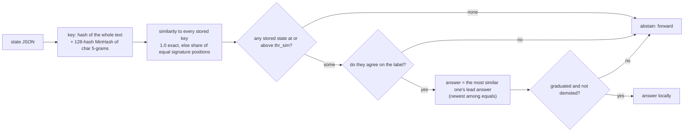

# memo

Retrieval over past lead answers. It answers **only an exact or near-duplicate** of a state it has already seen, and
abstains on everything else. No model, no encoder.

## Pipeline

## Features, model and confidence

- **Key:** the hash of the whole state text and a MinHash signature (128 hashes) of its character 5-gram set. Similarity
  is 1.0 for an exact match, else the share of equal signature positions (an estimate of Jaccard similarity, sd about
  0.02 near 0.95).
- **Answer:** stored states at similarity ≥ `thr_sim`; if none, or they disagree on the label, abstain (`proba` is none: the
  request is forwarded, never local). Otherwise the lead answer of the most similar. Stored probabilities are rebuilt from
  the label and the example weight, which is exact for a two-class question.
- **`thr_sim`** is chosen from {0.80, 0.85, 0.90, 0.95, 1.0} by the fit's own CV with **nested grouped CV**: for each outer
  fold the threshold is picked from inner folds of that fold's training rows alone, so no evaluated row's label influenced the
  threshold used on it. Among thresholds whose answers graduate, the one with the most coverage wins (ties: the
  stricter); if none graduates, 0.95 is kept and nothing is answered.
- **Agreement** is measured only over answered rows (0.0 below 30 of them), so an abstention is neither agreement nor
  disagreement. It must meet the shared bars on its own answers: with no duplicates it never graduates.
- **No novelty vector:** a near-duplicate is by definition not novel.

## Strengths and weaknesses

- Good: workloads that repeat themselves: retries, re-evaluations of the same item, a fixed evaluation set asked
  again, deduplicated caches. It answers exactly where reuse is reliable.
- Bad: anything without repeats. With unique states it never graduates and costs only the lookup.
- Exact and near duplicates inherit the lead's mistakes: it replays whatever the lead said, including a noisy answer.

## Cost and latency

Microseconds: a hash and a scan of the stored signatures. A forwarded state joins the stored keys at the next refit (the
cheap schedule, every 25 examples, in a ladder). Opt-in; not in the default tiers or candidates.

## Snapshot contents

`fits/<key>.safetensors`: `memo.sig` (`[n, 128]` U32), `memo.exact`, `memo.y`, and `memo.conf` for every stored state, and the
chosen `thr_sim` in `snapshot.json`. `states/<enc>.safetensors`: `memo.key` per state. The fit report carries `memo_sim`,
`memo_sim_grid`, `memo_sim_nested`, and `answered`.

## Worked example

Question: "Is this support ticket urgent?" asked again about a ticket that was re-sent with one extra word. The 5-gram
signatures are 97% equal, above `thr_sim = 0.95`; the only similar stored state was answered "urgent", so memo answers
"urgent" locally. A brand-new ticket matches nothing above 0.80, so memo abstains and the request goes to the lead.
