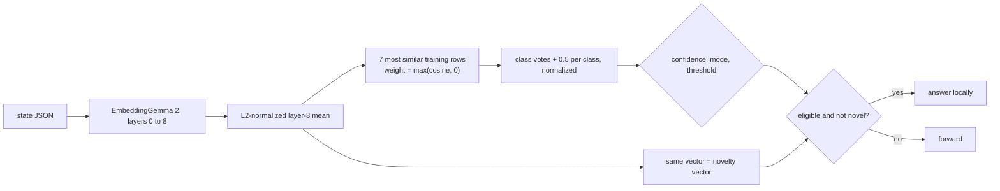

# neighbors

A cosine **7-nearest-neighbor vote** over layer-8 means. It answers by looking up how the lead answered the most similar
states it has seen.

## Pipeline

## Features, model and confidence

- **Features:** the same L2-normalized layer-8 mean as [probe](probe.md).
- **Model:** none to fit. Each of the 7 most similar training rows votes for its label, weighted by `max(cos, 0)`; ties
  go to the earlier row; every class gets +0.5 and the votes are normalized. The lead's confidence weights are not used.
  Out-of-fold probabilities use each fold's training rows.
- **Novelty vector:** the same normalized mean.

## Strengths and weaknesses

- Good: clustered inputs where similar states get similar answers, with no assumption of a linear boundary.
- Bad: the vote's confidence is coarse (with 7 neighbors it takes few distinct values, so graduation thresholds are
  blunt), and it scales its cost with the window. Rarely the winner, so it is not in any default ladder or race.

## Cost and latency

The same encoder cost as `probe` (tens of milliseconds), plus a scan over up to 2,000 stored vectors. `neighbors` is a valid
`--understudent` but **not** a ladder tier or `auto` candidate.

## Snapshot contents

`fits/<key>.safetensors`: `neighbors.{vecs,y}` (the stored vectors and labels) and `refs`. States hold the layer-8 mean.

## Worked example

Question: "Which queue should this ticket go to?" (choice: billing, bug, how-to). A new ticket's 7 nearest neighbors
are 5 billing, 1 bug, 1 how-to, with similarities near 0.9. Votes: billing ≈ 4.5 + 0.5, bug ≈ 0.9 + 0.5, how-to ≈
0.9 + 0.5, normalized to about 0.64 / 0.18 / 0.18. If the learned threshold is 0.6, it answers "billing" locally.
