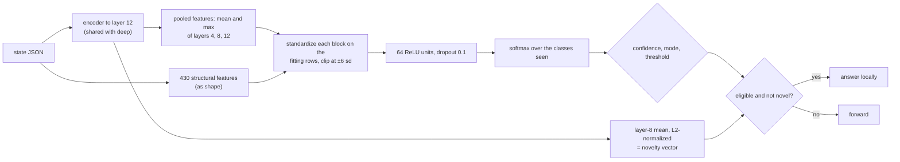

# net

A small neural classifier trained from scratch on the lead's answers. Its input is [deep](deep.md)'s pooled encoder
features joined with [shape](shape.md)'s structural features. It uses the same encoding as `deep`, so it shares `deep`'s
encode-cache entries.

## Pipeline

## Features, model and confidence

- **Features:** the pooled encoder block (mean and max over layers 4, 8, and 12, 3,072 dimensions for a one-field state;
  a pair uses the 4-way features) followed by shape's 430 features. Each block is standardized with the mean and standard
  deviation of the fitting rows only and clipped at ±6 sd.
- **Model:** one hidden layer of 64 ReLU units with dropout 0.1 and a softmax over the classes seen in training. Loss is
  cross-entropy weighted by the lead's confidence, with an L2 penalty of 1e-4. Optimizer is Adam (learning rate 2e-3) on
  mini-batches of 32.
- **Early stopping:** 15% of the training rows, chosen by a hash of their id group and the seed so siblings never straddle
  the split, are held out. The epoch with the lowest weighted validation loss wins (patience 5) and its weights are
  restored. The standardizers are fitted after the split, on the fitting rows only. With fewer than 20 fitting rows, fewer
  than 10 validation rows, or one class on either side, everything trains for at most 15 epochs.
- **Determinism:** a fixed seed per fit (`seed * 1000 + fold`) sets the initial weights, batch order, and dropout masks.
  Each fit is single-threaded and the folds run in parallel. Epochs are capped by a multiply-accumulate budget (1.6e10,
  between 6 and 40 epochs) instead of the clock, so a replay repeats exactly and a 2,000-row fit on about 3,500 inputs
  takes a few seconds. A fit with a single class returns no model.
- **Confidence:** the softmax probability, then the shared threshold and mode.
- **Novelty vector:** the L2-normalized layer-8 mean, as for deep.

## Strengths and weaknesses

- Good: it can combine meaning from the encoder with surface structure in one nonlinear model.
- Bad: with a few hundred examples and about 3,500 inputs, a hidden layer overfits more easily than a regularized linear
  model. In the committed validation it graduated later or at a lower agreement than `deep`.
- Bad: it pays the encoder cost of `deep` plus the network, and refits are on the long schedule.
- Opt-in: it is not in the default `ladder` or `auto` candidates. It applies `--layers`, `--no-chunk`, and the encode cache
  like `deep`.

## Cost and latency

It runs the encoder to layer 12 per request, like deep, so expect tens of milliseconds on CPU (the benchmark cost model
in [benchmarks](../benchmarks.md#cost-at-scale) groups it with the encoder designs at about 75 ms). `--prefer-fast`
models it at 600 µs plus 50 µs per token per encoder layer run. A race holding both `net` and `deep` encodes each state
once. The fit report carries `net_epochs` (the kept epoch for the final fit, then each fold) and `net_dim`.

## Measured results

From the wave-2 validation in
[SPEC.md](../../SPEC.md#wave-2-validation-net-checklist---abstain-calibrated) (local replays of recorded lead answers,
default policy, target 0.90, seed 0):

| set | net coverage / agreement (Wilson low) | deep |
|---|---|---|
| tool_failed | 27.3% / 95.1% (90.7) | 25.3% / 98.0% (94.4) |
| incident_severity | 0.0% | 11.3% / 91.2% (82.1) |
| passage_answers | 0.0% | 14.5% / 97.7% (92.0) |

It won no question there. Under the calibrated policy it covered nothing on any of the three.

## Settings

Select it with `--understudent net`, as a `--tiers` entry, or in `--candidates`. `--layers`, `--attn-layer` and `--readout`
apply to deep, net and a ladder with a deep or net tier. The network constants (`HIDDEN`, `DROPOUT`, `LR`, `WEIGHT_DECAY`,
`BATCH`, `PATIENCE`, `VAL_PERCENT`, `MAC_BUDGET`) are fixed in `src/netdesign.rs`.

## Snapshot contents

Both standardizers, `w1`, `b1`, `w2`, `b2`, the class indices the outputs cover, and the kept epoch.

See also [deep](deep.md) and [shape](shape.md).
