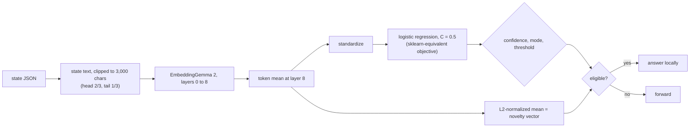

# `probe`

A layer-8 token mean from EmbeddingGemma 2, then a standardized logistic regression. It is the plainest "embed it and fit a
linear probe" baseline, and it is the reference the other neural designs are measured against.

## Pipeline

## Features, model and confidence

- **Features:** the mean over tokens of the layer-8 hidden states. The encoder stops at layer 8 and no token states are
  stored. Texts longer than 3,000 characters are **clipped** (head 2/3, tail 1/3), not chunked.
- **Model:** weighted logistic regression, `C·Σ wᵢ lossᵢ + ½‖w‖²`, intercept unpenalised, the same objective as
  scikit-learn's `LogisticRegression(C=0.5, lbfgs, L2)`. `pair` questions use `[x, y, x − y, x ⊙ y]`.
- **Novelty vector:** the L2-normalized layer-8 mean.

## Strengths and weaknesses

- Good: topic and kind of text, tone, anything a sentence-level embedding captures, with paraphrase tolerance that
  [keywords](keywords.md) lacks.
- Bad: a needle in a long text (the mean washes it out), clipped long states, and questions that need exact tokens.
  [deep](deep.md) adds max pooling and attention for those.

## Cost and latency

The transformer's first 8 layers: tens of milliseconds per item on CPU (about 20 to 105 ms in the committed replay in
`runs/v1-target97`, depending on text length). In a ladder it shares one forward pass with deep when the texts agree
(states under 3,000 characters): `probe`'s pass runs layers up to 8 and keeps the partial state, so deep resumes it
instead of recomputing.

## Snapshot contents

`fits/<key>.safetensors`: `pool.{mu,sd,coef,intercept}` and `refs`. `states/<enc>.safetensors`: one mean vector per
state (`mean<i>.pool` in a ladder).

## Worked example

Question: "Does this passage mention a refund?" The layer-8 mean encodes that "we will send your money back" and "you are
owed a reimbursement" are close to "refund". After a few hundred examples, `p_yes = 0.91` for a fresh passage that
paraphrases a refund without the word, and the question graduates at a threshold of 0.88. A passage that only shares a
keyword like "return" in another sense lands near the decision boundary, below the threshold, and is forwarded.
