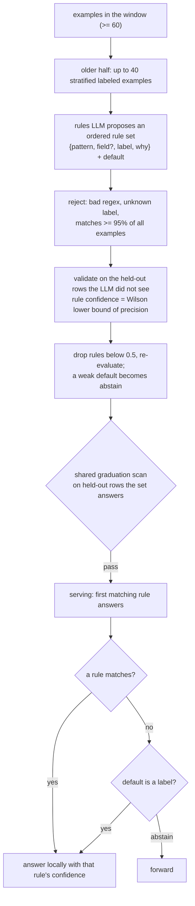

# rules

Decision rules that an LLM writes as **regexes** and that Understudy checks statistically against the lead. The
cheapest tier: microseconds, no model, no encoder.

## Pipeline

## Features, model and confidence

- **Rule set:** ordered `{"pattern", "field"?, "label", "why"}` plus a `default` (a label or `"abstain"`). First match wins;
  `field` restricts the regex to one top-level state field. The `regex` crate runs in linear time (no look-around).
- **Proposal:** at a refit with at least 60 examples when there is no rule set, or the current one is not graduated and at
  least 100 new examples arrived since the last proposal; at most 5 proposals per question. The LLM sees the question spec
  plus up to 40 stratified labeled examples (texts clipped at 6,000 characters) from the **older** half of the window.
  Re-proposals also show examples the previous set got wrong. Defaults: `--rules-llm-url`, `--rules-llm-model`
  (a fast chat model), low reasoning effort, JSON output.
- **Validation** is on examples the LLM did **not** see. A rule's confidence is the Wilson lower bound of its precision on
  the held-out rows it answers (rows taken by an earlier rule are excluded). Coverage is the share of held-out rows answered
  locally; an abstention is never local. Graduation is the usual symmetric or one-sided scan over those rows
  ([graduation](../graduation.md)), and the one-sided-yes mode fits a rule set that confirms "yes" and abstains otherwise.
- **Determinism:** every LLM request and response is cached by the SHA-256 of the request body in `<snapshot>/rules_llm.jsonl`
  and, with `--rules-cache FILE`, in that file. A replay with a warm cache makes no network calls and decides identically.
- **Novelty:** none.

## Strengths and weaknesses

- Good: questions with a crisp lexical rule: credential patterns, a specific status string, a marker the lead keys on. The
  rules are human-readable (`listing` in the fit report), so you can *read* what it learned.
- Bad: anything fuzzy. Rules fire on text, not meaning, and the held-out check will correctly refuse to graduate a weak set.
  It needs an LLM endpoint to propose rules; without a cache and without network, no rules appear and the question stays
  in learning. In a ladder `rules` must be the first tier.

## Cost and latency

Microseconds per item at serve time, plus an LLM call (a few seconds, at most 5 per question) at proposal time. A ladder
that answers from rules computes no other tier.

## Snapshot contents

`snapshot.json`: the active rule set with held-out stats (rules, dropped rules and why, held-out n, agreement, coverage,
proposal count, request key, human-readable `listing`). `rules_llm.jsonl`: the LLM cache. States hold the rule input
(the state's fields as text).

## Worked example

Question: "Does this text contain a leaked credential?" The LLM proposes
`{"pattern": "AKIA[0-9A-Z]{16}", "label": "true"}` and `{"pattern": "-----BEGIN [A-Z ]*PRIVATE KEY-----", "label":
"true"}` with default `"abstain"`. On 120 held-out rows, the key-prefix rule matches 18 and all 18 are "true" (Wilson
lower bound 0.82 above the 0.5 floor, kept); the second matches 9 with 9 correct. In one-sided-yes mode, a text
matching either rule is answered "true" locally, and everything that matches neither is forwarded to the lead.
