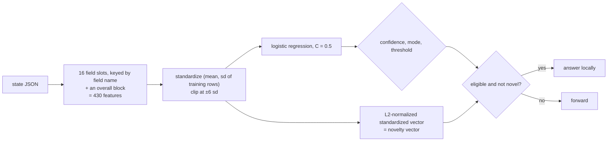

# shape

A calibrated logistic regression over **structural features** of the state: lengths, shares, markdown, URLs,
refusal and hedging markers, echoed numbers and JSON field types. **No encoder and no model file.**

## Pipeline

## Features, model and confidence

`DIM = 430` features:

- **Per field slot.** 16 slots, each chosen by a stable hash of the field's *name*, so adding or removing a field never
  shifts another field's slot, and a missing field shows as its presence bit dropping. A non-object state is one field
  named `""`. Per slot: presence, JSON type (null, bool, number, string, list, object), the numeric value (signed log), and
  boolean value, then 16 text features of the field's text: log chars, words, and lines; the share of digits, uppercase,
  and punctuation; log counts of markdown headers, bullets, code fences, URLs, and question marks; log counts of refusal,
  apology, and hedging markers (fixed lexicons of substrings); the log count of numbers; and the share of the field's
  numbers that another field also holds (an answer echoing its question).
- **Overall block.** The same 16 text features of the whole state, the log number of fields, the state's own type, the
  log ratio of character lengths for each pair among the first four slots, and the log length ratio of the question's
  `pair` fields.
- **Standardization** uses the training rows' mean and population sd, clipped at ±6 sd. Out-of-fold fits standardize
  **per fold** from that fold's training rows only, so graduation never sees a held-out row's statistics.
- **Novelty vector:** the standardized, clipped feature vector, L2-normalized.

## Strengths and weaknesses

- Good: questions about the *shape* of a response, not its meaning: "is this a refusal", "is the answer just echoing the
  question", "is this tool output empty or truncated". Useful in a race as a cheap structural tier.
- Bad: meaning. It cannot tell a correct answer from a wrong one of the same shape. It also tends to pick up length
  as a cue, so audit it on states whose length distribution may drift.
- When two of a state's fields collide on a slot, only one keeps its per-field columns.

## Cost and latency

Roughly 30 to 500 µs per item and a very cheap refit, with no model loaded. On the cheap refit schedule in a ladder. It is
opt-in: not in the default tiers or candidates.

## Snapshot contents

`fits/<key>.safetensors`: `pool.{mu,sd,coef,intercept}` (the standardizer and model) and `refs`. `states/<enc>.safetensors`:
`shape.v`, the feature vector. A snapshot saved by an earlier feature layout must be rebuilt (the `DIM` changed).

## Worked example

Question: "Did the assistant refuse the request?" Refusals share structure: a short text, an apology marker ("I'm
sorry"), a hedging marker ("I can't"), no code fences, no digits. After a few hundred answers the apology and length
features carry large weights. A new reply "I'm sorry, but I can't help with that." gets `p_yes = 0.98`. The state's
length features are typical, so it is not novel, and `shape` answers locally without loading any model.
